# 用例文本（Use Cases）

> **文档编号**：`specs/03-use-cases.md`
> **制定依据**：`02-requirements.md`
> **版本**：v1.0
> **日期**：2026-09-19
>
> 本文件定义系统的全部用例。每个用例含：用例编号、名称、主要参与者、次要参与者、前置条件、后置条件、基本事件流、备选事件流、异常事件流、关联需求。
>
> **重点详述的用例**：UC-101 办理借书、UC-102 办理还书、UC-005 预约图书、UC-201 办理借阅证、UC-102 中的计算超期罚款（标注为 UC-102a）。

---

## 1. 参与者总览

| 参与者 | 说明 |
|---|---|
| 读者 Reader | 抽象参与者，泛指全部读者 |
| 学生读者 StudentReader | 泛化自 Reader，含专科生、本科生、研究生、博士生 |
| 教师读者 TeacherReader | 泛化自 Reader |
| 图书管理员 Librarian | 代理读者完成借还，管理流通业务 |
| 系统管理员 SystemAdmin | 维护系统基础数据与规则 |

---

## 2. 读者相关用例

### UC-001 注册账号

| 项 | 内容 |
|---|---|
| **用例编号** | UC-001 |
| **用例名称** | 注册账号 |
| **主要参与者** | 读者 |
| **次要参与者** | 无 |
| **前置条件** | 无（未登录状态可访问） |
| **后置条件** | 读者账号创建成功，可登录；但尚未具备借阅资格 |
| **关联需求** | FR-002、BR-048 |

**基本事件流**：

1. 读者进入注册页面。
2. 读者填写用户名、密码、姓名、院系、读者类型。
3. 系统校验用户名格式（3-32 位，仅字母、数字、下划线）与唯一性。
4. 系统校验密码长度（6-24 位）。
5. 系统校验读者类型在允许枚举内（专科生、本科生、研究生、博士生、教师）。
6. 系统使用 bcrypt 哈希密码。
7. 系统创建读者账号与读者记录，状态为正常。
8. 系统返回注册成功，提示读者可在登录后前往图书馆办理借阅证。

**备选事件流**：

- **A1 用户名已存在**：在步骤 3，系统检测到用户名重复，返回 409 冲突，提示"用户名已被占用"，返回步骤 2。
- **A2 用户名格式非法**：在步骤 3，系统检测到用户名长度不足或包含非法字符，返回 422，提示具体原因，返回步骤 2。
- **A3 密码长度非法**：在步骤 4，密码不足 6 位或超过 24 位，返回 422，提示"密码长度须为 6-24 位"，返回步骤 2。
- **A4 读者类型非法**：在步骤 5，读者类型不在枚举内，返回 422，返回步骤 2。

**异常事件流**：

- **E1 数据库写入失败**：在步骤 7，数据库异常，返回 500，事务回滚，账号未创建。系统记录错误日志。

---

### UC-002 登录

| 项 | 内容 |
|---|---|
| **用例编号** | UC-002 |
| **用例名称** | 登录 |
| **主要参与者** | 读者、图书管理员、系统管理员 |
| **次要参与者** | 无 |
| **前置条件** | 账号已存在且未被软删除 |
| **后置条件** | 登录成功，签发 JWT Token；若为读者且存在到期/超期记录，返回提醒信息 |
| **关联需求** | FR-001、FR-020、BR-045 ~ BR-047 |

**基本事件流**：

1. 用户输入用户名与密码。
2. 系统按用户名查找账号。
3. 系统使用 bcrypt 校验密码。
4. 系统校验账号未被软删除。
5. 系统签发 JWT Token（有效期 24 小时），Token 中携带用户 ID 与角色。
6. 系统判断用户角色：
   - 若为**读者**：查询其 3 天内到期与已超期的借阅记录，若存在则一并返回告警列表（见 UC-008）。
   - 若为**图书管理员**或**系统管理员**：不返回告警。
7. 系统返回 Token、用户信息与角色。

**备选事件流**：

- **A1 用户名不存在**：在步骤 2，未找到账号，返回 401，提示"用户名或密码错误"（不暴露具体原因）。
- **A2 密码错误**：在步骤 3，bcrypt 校验失败，返回 401，提示"用户名或密码错误"。
- **A3 账号已删除**：在步骤 4，账号为软删除状态，返回 401，提示"用户名或密码错误"。

**异常事件流**：

- **E1 Token 签发失败**：在步骤 5，密钥缺失或签名异常，返回 500。

---

### UC-003 查询图书

| 项 | 内容 |
|---|---|
| **用例编号** | UC-003 |
| **用例名称** | 查询图书 |
| **主要参与者** | 读者、图书管理员、系统管理员 |
| **次要参与者** | 无 |
| **前置条件** | 用户已登录 |
| **后置条件** | 无数据变更 |
| **关联需求** | FR-014、BR-036、BR-037 |

**基本事件流**：

1. 用户输入检索条件（题名关键字、作者、ISBN、借出物类型，可任意组合）。
2. 用户可选择"只看有可借副本"筛选。
3. 系统按条件查询未被软删除的图书标题。
4. 系统统计每个标题的副本总数与可借副本数。
5. 系统分页返回结果（默认每页 20 条）。
6. 用户在结果中选择某一标题查看详情，系统返回该标题的各副本状态。

**备选事件流**：

- **A1 无匹配结果**：在步骤 5，返回空列表，提示"未找到匹配的图书"。
- **A2 未登录访问**：在任何步骤，系统检测未携带有效 Token，返回 401。
- **A3 结果超过单页上限**：在步骤 5，系统按分页参数返回并提示总条数。

**异常事件流**：

- **E1 检索参数格式错误**：如 ISBN 格式非法，返回 422。

---

### UC-004 查询借阅信息

| 项 | 内容 |
|---|---|
| **用例编号** | UC-004 |
| **用例名称** | 查询借阅信息 |
| **主要参与者** | 读者 |
| **次要参与者** | 无 |
| **前置条件** | 读者已登录 |
| **后置条件** | 无数据变更 |
| **关联需求** | FR-019、BR-039、BR-037 |

**基本事件流**：

1. 读者进入"我的借阅"页面。
2. 系统根据 Token 中的用户 ID 定位读者（**不信任请求参数中的 reader_id**）。
3. 系统查询该读者的当前借阅列表，计算每条的剩余天数、是否超期、是否可续借、已续借次数。
4. 系统查询该读者的历史借阅记录。
5. 系统查询该读者的预约列表及排队位置。
6. 系统查询该读者的罚款记录（金额、状态、产生时间）。
7. 系统返回上述全部信息。**读者界面不展示经办图书管理员 ID**。

**备选事件流**：

- **A1 无任何借阅记录**：在步骤 3，返回空列表，提示"暂无借阅记录"。
- **A2 读者尝试查询他人**：若读者在请求中篡改 reader_id，系统校验资源归属失败，返回 403 `PERMISSION_DENIED`。

**异常事件流**：

- **E1 Token 过期**：返回 401，前端跳转登录页。

---

### UC-005 预约图书

> **重点详述用例**

| 项 | 内容 |
|---|---|
| **用例编号** | UC-005 |
| **用例名称** | 预约图书 |
| **主要参与者** | 读者 |
| **次要参与者** | 图书管理员（还书时触发预留） |
| **前置条件** | ① 读者已登录；② 读者持有有效借阅证（`ACTIVE`）；③ 目标标题未被软删除 |
| **后置条件** | 创建预约记录（状态 `ACTIVE`），读者占用 1 个借阅额度；若队列此前为空且该标题无在借副本，预约进入等待 |
| **关联需求** | FR-021、BR-020 ~ BR-023、BR-026、BR-012 |

**基本事件流**：

1. 读者在图书详情页选择"预约"。
2. 系统校验读者身份与借阅资格：
   - 读者存在且未被软删除；
   - 读者持有状态为 `ACTIVE` 的借阅证。
3. 系统校验目标标题存在且未被软删除。
4. 系统统计该标题下的副本状态，判断是否存在任一 `AVAILABLE` 副本。
5. 系统确认该标题**所有副本均不可借**，允许预约。
6. 系统校验该读者对该标题不存在其他有效预约（`ACTIVE` 或 `READY`）。
7. 系统统计该标题的当前有效预约队列人数，确认未达到 5 人上限。
8. 系统校验读者当前占用额度未超出最大借阅数量。
9. 系统创建预约记录，状态 `ACTIVE`，记录创建时间。
10. 系统返回预约成功、队列位置与预计等待说明。

**备选事件流**：

- **A1 读者不存在或已删除**：在步骤 2，返回 404。
- **A2 读者无有效借阅证**：在步骤 2，返回 `CARD_REQUIRED`，HTTP 400，提示"请先办理借阅证"。
- **A3 标题不存在或已删除**：在步骤 3，返回 404。
- **A4 尚有可借副本**：在步骤 4，检测到存在 `AVAILABLE` 副本，返回 `ITEM_AVAILABLE_NO_RESERVATION`，HTTP 400，提示"该图书尚有可借副本，无需预约"。
- **A5 重复预约**：在步骤 6，检测到该读者对该标题已有 `ACTIVE` 或 `READY` 的预约，返回 `DUPLICATE_RESERVATION`，HTTP 409。
- **A6 队列已满**：在步骤 7，队列人数已达 5 人，返回 `RESERVATION_QUEUE_FULL`，HTTP 409，提示"预约人数已满，请稍后再试"。
- **A7 超出借阅额度**：在步骤 8，读者占用额度已达上限，返回 `BORROW_LIMIT_EXCEEDED`，HTTP 400。

**异常事件流**：

- **E1 并发预约导致队列超员**：两个读者同时预约队列最后一个名额，系统在事务内串行化处理，后者返回 `RESERVATION_QUEUE_FULL`。
- **E2 数据库写入失败**：事务回滚，预约未创建。

**特殊需求**：

- 预约队列顺序由 `created_at` 升序决定，须保证同一时刻并发创建的预约具有可区分的时间戳。

---

### UC-006 取消预约

| 项 | 内容 |
|---|---|
| **用例编号** | UC-006 |
| **用例名称** | 取消预约 |
| **主要参与者** | 读者 |
| **次要参与者** | 无 |
| **前置条件** | 读者已登录，且存在本人 `ACTIVE` 或 `READY` 状态的预约 |
| **后置条件** | 预约状态置为 `CANCELLED`，释放占用的 1 个借阅额度；若被取消的是 `READY` 预约，其 `RESERVED` 副本按 BR-024a 转交 |
| **关联需求** | FR-022、BR-021、BR-024a、BR-025a |

**基本事件流**：

1. 读者在"我的预约"列表中选择一条预约并点击"取消"。
2. 系统校验该预约属于当前登录读者。
3. 系统校验预约状态为 `ACTIVE` 或 `READY`（**两种状态均可取消**，BR-025a）。
4. 系统将预约状态置为 `CANCELLED`。
5. 系统释放该读者占用的借阅额度。
6. **若被取消的预约处于 `READY` 状态**，从队列中取下一个有效预约并完成副本交接：转交成功则对方状态由 `ACTIVE` 置为 `READY`，副本保持 `RESERVED`；队列已无有效预约则将副本释放为 `AVAILABLE`（BR-024a）。
7. 系统重新计算该标题的队列顺序，后续读者位置前移。
8. 系统返回取消成功。

**备选事件流**：

- **A1 预约不属于本人**：在步骤 2，返回 403。
- **A2 预约状态不可取消**：在步骤 3，若状态为 `EXPIRED` 或 `CANCELLED`，返回 400，提示"该预约已失效或已取消"。
- **A3 预约不存在**：返回 404。

**异常事件流**：

- **E1 被取消的是 `READY` 预约**：在步骤 6，副本**不直接变为 `AVAILABLE`**，而是优先转交给队列中的下一位有效预约（对方 `ACTIVE` → `READY`，副本仍为 `RESERVED`）；仅当队列已无有效预约时，副本才释放为 `AVAILABLE`。此判断与交接在同一事务内完成，避免出现无人接管的 `RESERVED` 副本。

---

### UC-007 续借图书

| 项 | 内容 |
|---|---|
| **用例编号** | UC-007 |
| **用例名称** | 续借图书 |
| **主要参与者** | 读者 |
| **次要参与者** | 无 |
| **前置条件** | 读者已登录，且存在本人名下未归还的借阅记录 |
| **后置条件** | 借阅记录的 `due_at` 延长 7 天，续借次数 +1 |
| **关联需求** | FR-018、BR-015 ~ BR-019 |

**基本事件流**：

1. 读者在"我的借阅"中选择一条未归还的记录，点击"续借"。
2. 系统校验该借阅记录属于当前登录读者。
3. 系统校验该记录未超期（`returned_at` 为空且当前时间 ≤ `due_at`）。
4. 系统校验该记录已续借次数 < 2。
5. 系统校验读者当前占用额度未超出最大借阅数量。
6. 系统将 `due_at` 延长 7 天，续借次数 +1。
7. 系统记录操作人（读者本人 ID）与操作时间。
8. 系统返回续借成功与新的到期时间。

**备选事件流**：

- **A1 记录不属于本人**：在步骤 2，返回 403。
- **A2 已超期**：在步骤 3，返回 `RENEW_OVERDUE`，HTTP 400，提示"图书已超期，无法续借"。
- **A3 续借次数已达上限**：在步骤 4，已续借 2 次，返回 `RENEW_LIMIT_EXCEEDED`，HTTP 400。
- **A4 超出借阅额度**：在步骤 5，返回 `BORROW_LIMIT_EXCEEDED`，HTTP 400。
- **A5 记录不存在**：返回 404。

**异常事件流**：

- **E1 并发续借**：同一记录被重复提交，系统在事务内校验续借次数，第二次请求返回 `RENEW_LIMIT_EXCEEDED`。

**补充说明**：

- 存在预约排队**不构成**禁止续借的条件（BR-018）。
- 续借不额外占用借阅额度（BR-019）。
- 单次续借固定延长 7 天，与读者类型无关（BR-015）。
- 实验文档未提及续借功能，此为本组主动扩展，扩展理由：续借是真实图书馆的普遍业务，且能体现策略模式与规则可配置性。

---

### UC-008 接收到期提醒

| 项 | 内容 |
|---|---|
| **用例编号** | UC-008 |
| **用例名称** | 接收到期提醒 |
| **主要参与者** | 读者 |
| **次要参与者** | 无 |
| **前置条件** | 读者登录成功 |
| **后置条件** | 无数据变更 |
| **关联需求** | FR-020 |

**基本事件流**：

1. 读者登录成功。
2. 系统查询该读者的未归还借阅记录。
3. 系统筛选出 `due_at` 在 3 天内（含当天）或已超期的记录。
4. 若筛选结果非空，系统将告警列表随登录响应一并返回。
5. 前端以 Dialog 集中展示全部告警记录（书名、到期时间、剩余天数或超期天数）。
6. 读者点击"知道了"关闭 Dialog。**同一会话内不再重复提醒**。

**备选事件流**：

- **A1 无即将到期或超期记录**：在步骤 3，筛选结果为空，系统不返回告警，前端不弹窗。
- **A2 登录者为图书管理员或系统管理员**：系统不执行本流程。

**异常事件流**：

- 无。

---

## 3. 图书管理员相关用例

### UC-101 办理借书

> **重点详述用例**（实验文档明确要求体现 9 个步骤）

| 项 | 内容 |
|---|---|
| **用例编号** | UC-101 |
| **用例名称** | 办理借书 |
| **主要参与者** | 图书管理员 |
| **次要参与者** | 读者（在场，提供借阅证） |
| **前置条件** | ① 图书管理员已登录且角色为 `LIBRARIAN` 或 `ADMIN`；② 读者持有借阅证；③ 待借图书为馆藏副本 |
| **后置条件** | 创建借阅记录（状态 `BORROWED`），`due_at` 已设置；馆藏副本状态变为 `BORROWED`；读者占用额度 +1 |
| **关联需求** | FR-015、FR-016、BR-001、BR-006 ~ BR-014、BR-040 |

#### 第一阶段：借书前置校验（预检查）

1. 图书管理员输入读者的借阅证号。
2. 系统校验操作人角色为图书管理员或系统管理员，否则拒绝。
3. 系统**验证借阅证是否存在且状态有效**（`ACTIVE`）。
4. 系统定位借阅证对应的读者。
5. 系统**检查读者是否已超过该读者类型的最大借阅数量**（占用额度 = 未归还借阅数 + 有效预约数）。
6. 系统**检查读者是否存在超期未归还的图书**。
7. 系统检查读者是否存在未缴清的罚款。
8. 系统**显示读者信息**（姓名、读者类型、借阅额度、当前占用额度、剩余可借数量）以及上述校验结果。
9. 若任一校验失败，系统提示具体原因，流程终止。

#### 第二阶段：办理借出

10. 图书管理员**输入图书副本的馆藏条码**。
11. 系统**验证图书是否为本馆藏书且状态可借**（状态为 `AVAILABLE`）。
12. 系统在单个事务内执行：
    - 创建一个借阅记录（`Loan`），状态 `BORROWED`，记录借出时刻 `borrowed_at`；
    - 计算并设置到期时刻 `due_at` = `borrowed_at` + 该读者类型的借阅天数；
    - 记录**经办图书管理员 ID**；
    - 将馆藏副本状态更新为 `BORROWED`。
13. 系统**更新读者的账户状态**（占用额度 +1，由借阅记录实时计算，无需单独字段）。
14. 系统返回借出成功，显示图书题名、条码、借阅人、到期时间。

**基本事件流**：步骤 1-14 顺序执行。

**备选事件流**：

- **A1 操作人权限不足**：在步骤 2，操作人为读者，返回 `PERMISSION_DENIED`，HTTP 403。
- **A2 借阅证无效**：在步骤 3，借阅证不存在，或状态为 `SUSPENDED` / `CANCELLED` / `EXPIRED`，返回 `CARD_INVALID`，HTTP 400，提示"借阅证无效或已注销"。
- **A3 超过借阅数量**：在步骤 5，占用额度 ≥ 最大借阅数量，返回 `BORROW_LIMIT_EXCEEDED`，HTTP 400，提示"该读者已达最大借阅数量（N 册）"。
- **A4 存在超期未还**：在步骤 6，返回 `OVERDUE_LOAN_EXISTS`，HTTP 400，提示"该读者有超期未还图书，请先归还"。
- **A5 存在未缴罚款**：在步骤 7，返回 `UNPAID_FINE_EXISTS`，HTTP 400，提示"该读者有未缴清罚款，请先缴纳"。
- **A6 图书不是本馆藏书**：在步骤 11，条码不存在，返回 `ITEM_NOT_FOUND`，HTTP 404。
- **A7 图书不可借**：在步骤 11，副本状态为 `BORROWED` / `RESERVED` / `LOST` / `DAMAGED` / `REMOVED`，返回 `ITEM_NOT_AVAILABLE`，HTTP 400，提示"该副本当前不可借出"。

**异常事件流**：

- **E1 事务失败**：在步骤 12，任一步骤失败则整体回滚，借阅记录不创建、副本状态不变。
- **E2 并发借同一副本**：两名图书管理员同时办理同一副本的借出，系统在事务内串行化处理，后者返回 `ITEM_NOT_AVAILABLE`。
- **E3 并发借书导致超额**：同一读者在两个窗口同时借书，系统在事务内校验额度，后者可能返回 `BORROW_LIMIT_EXCEEDED`。

**特殊需求**：

- 校验顺序**固定**为：权限 → 借阅证 → 数量 → 超期 → 罚款 → 副本。这决定了失败时返回哪个错误码。
- 借书操作**必须**由图书管理员或系统管理员执行，读者不可自行借书（BR-040）。

---

### UC-102 办理还书

> **重点详述用例**

| 项 | 内容 |
|---|---|
| **用例编号** | UC-102 |
| **用例名称** | 办理还书 |
| **主要参与者** | 图书管理员 |
| **次要参与者** | 读者（在场归还图书） |
| **前置条件** | ① 图书管理员已登录；② 待归还图书为馆藏副本且处于借出状态 |
| **后置条件** | 借阅记录状态置为 `RETURNED` 并记录归还时间；副本状态更新为 `AVAILABLE` 或 `RESERVED`；若超期则生成罚款记录 |
| **关联需求** | FR-017、FR-025、BR-024、BR-027 ~ BR-030、BR-040 |

**基本事件流**：

1. 图书管理员**输入图书的馆藏条码**（**无需刷借阅证**）。
2. 系统校验操作人角色为图书管理员或系统管理员。
3. 系统**验证该馆藏副本存在且属于本馆**。
4. 系统**查找该副本对应的未归还借阅记录**（`returned_at` 为空）。
5. 系统设置 `returned_at` 为当前时刻，将借阅记录状态置为 `RETURNED`。
6. 系统**判断是否超期**（`returned_at` > `due_at`）：
   - 若未超期：跳过步骤 7。
   - 若已超期：执行步骤 7（见 UC-102a）。
7. **计算超期罚款**（详见 UC-102a），生成罚款记录，状态 `UNPAID`。
8. 系统判断该图书标题是否存在有效预约队列：
   - 若存在：将副本状态置为 `RESERVED`，并将队首读者的预约状态由 `ACTIVE` 改为 `READY`，**更新借阅信息**为该预约保留该书。
   - 若不存在：将副本状态置为 `AVAILABLE`。
9. 系统记录经办图书管理员 ID，**删除或更新相应的借阅信息**（借阅记录转为历史记录）。
10. 系统返回还书成功，若产生罚款则一并显示罚款金额与缴纳方式。

**备选事件流**：

- **A1 操作人权限不足**：在步骤 2，返回 403。
- **A2 图书不是本馆藏书**：在步骤 3，条码不存在，返回 `ITEM_NOT_FOUND`，HTTP 404，提示"该图书不是本馆藏书"。
- **A3 未找到借阅记录**：在步骤 4，该副本无未归还的借阅记录，返回 `LOAN_NOT_FOUND`，HTTP 404，提示"未找到该图书的借阅记录"。
- **A4 存在预约排队**：在步骤 8，副本置为 `RESERVED`，触发 UC-005 的预留逻辑，不进入可借状态。
- **A5 归还时发现图书破损**：图书管理员可在还书后单独将副本标记为 `DAMAGED`（见 UC-212），本用例不自动判定。

**异常事件流**：

- **E1 事务失败**：在步骤 5-9，任一步骤失败整体回滚，借阅记录仍为未归还，副本状态不变。
- **E2 重复提交还书**：同一副本被两次提交还书，第二次在步骤 4 找不到未归还记录，返回 `LOAN_NOT_FOUND`。

**特殊需求**：

- 还书**仅凭馆藏条码**，无需借阅证（BR-020 对应决策 D-20）。
- 整个还书流程**必须**在单个事务内完成，避免出现"已归还但罚款丢失"或"副本状态错乱"。

---

### UC-102a 计算超期罚款

> **重点详述用例**（实验文档明确要求重点描述）

| 项 | 内容 |
|---|---|
| **用例编号** | UC-102a |
| **用例名称** | 计算超期罚款 |
| **主要参与者** | 系统（由 UC-102 触发） |
| **次要参与者** | 图书管理员 |
| **前置条件** | 借阅记录已超期（`returned_at` > `due_at`） |
| **后置条件** | 生成罚款记录（`FineRecord`），状态 `UNPAID` |
| **关联需求** | FR-025、BR-027 ~ BR-030 |

**基本事件流**：

1. 系统计算逾期时长：`overdue_seconds = returned_at - due_at`。
2. 系统将逾期时长向上取整为**逾期天数**（不足一天按一天计）。
   - 示例：逾期 1 天 2 小时 → 计为 2 天。
3. 系统从 `fine_rules` 表读取该借出物类型的单价、宽限期天数、单笔封顶金额。
4. 系统计算**计罚天数** = max(逾期天数 - 宽限期天数, 0)。
   - 逾期 0-2 天 → 计罚 0 天（宽限期内不计罚）。
   - 逾期 3 天 → 计罚 1 天（**只计超出宽限期的天数**）。
5. 系统计算**罚款金额** = min(计罚天数 × 单价, 单笔封顶金额)。
   - 使用 `Decimal` 类型计算，**不使用浮点数**，避免精度误差。
6. 系统创建罚款记录，记录金额、产生时间、关联的借阅记录 ID、状态 `UNPAID`。
7. 系统在还书响应中返回罚款金额。

**备选事件流**：

- **A1 未超期或宽限期内**：在步骤 4，计罚天数为 0，罚款金额为 0，**不生成罚款记录**。
- **A2 触发封顶**：在步骤 5，计算结果超过封顶金额，按封顶金额记录。

**异常事件流**：

- **E1 罚款规则缺失**：在步骤 3，`fine_rules` 表中无该借出物类型的规则，系统记录错误日志，按兜底单价 0 处理并告警，不阻断还书流程。

**计算示例**（以中文图书单价 0.20 元/天、宽限期 2 天、封顶 100 元为例）：

| 逾期天数 | 计罚天数 | 罚款金额 | 说明 |
|---:|---:|---:|---|
| 0 | 0 | 0.00 | 按期归还 |
| 1 | 0 | 0.00 | 宽限期内 |
| 2 | 0 | 0.00 | 宽限期内 |
| 3 | 1 | 0.20 | 第 3 天起计罚 |
| 10 | 8 | 1.60 | |
| 100 | 98 | 19.60 | |
| 1000 | 998 | 100.00 | 触发封顶 |

**特殊需求**：

- 罚款计算逻辑**必须**位于领域层（`FineRuleService` 或等价策略类），不得写在路由处理函数中。
- 单价、宽限期、封顶金额**必须**从数据库读取，不得硬编码（BR-049）。

---

### UC-103 查询读者借阅信息

| 项 | 内容 |
|---|---|
| **用例编号** | UC-103 |
| **用例名称** | 查询读者借阅信息 |
| **主要参与者** | 图书管理员 |
| **次要参与者** | 系统管理员 |
| **前置条件** | 图书管理员已登录 |
| **后置条件** | 无数据变更 |
| **关联需求** | FR-019、BR-039 |

**基本事件流**：

1. 图书管理员输入借阅证号或读者姓名。
2. 系统查找对应读者（**图书管理员可查询任意读者**，不受资源归属限制）。
3. 系统返回该读者的当前借阅列表、历史借阅记录、预约列表、罚款记录。
4. 与 UC-004 不同，本用例的返回结果**包含**经办图书管理员 ID（用于内部审计）。

**备选事件流**：

- **A1 读者不存在**：返回 404。
- **A2 查询结果为空**：返回空列表。
- **A3 查询到已软删除的借阅证**：图书管理员无法看到 `CANCELLED` 的借阅证（BR-037）。

**异常事件流**：

- 无。

---

### UC-104 收缴罚款

| 项 | 内容 |
|---|---|
| **用例编号** | UC-104 |
| **用例名称** | 收缴罚款 |
| **主要参与者** | 图书管理员 |
| **次要参与者** | 系统管理员 |
| **前置条件** | 该读者存在状态为 `UNPAID` 的罚款记录 |
| **后置条件** | 罚款记录状态置为 `PAID`，记录经办人与缴纳时间 |
| **关联需求** | FR-026、BR-031、BR-011 |

**基本事件流**：

1. 图书管理员查询目标读者的罚款记录。
2. 图书管理员确认读者已线下缴纳现金。
3. 图书管理员在系统中将该罚款记录标记为 `PAID`。
4. 系统记录经办人 ID 与操作时间。
5. 系统返回标记成功。
6. 若该读者已无其他未缴罚款，其借书权限恢复（BR-011 的禁借条件解除）。

**备选事件流**：

- **A1 罚款记录不存在**：返回 404。
- **A2 罚款已缴纳**：在步骤 3，记录状态已为 `PAID`，返回 400，提示"该罚款已缴纳"。
- **A3 读者还有多条未缴罚款**：在步骤 6，禁借条件继续生效，直到全部缴清。

**异常事件流**：

- 无。

**特殊需求**：

- 缴纳方式为**线下现金**，系统不接入任何支付渠道（符合 `00-project-brief.md` §8）。

---

## 4. 系统管理员相关用例

### UC-201 办理借阅证

> **重点详述用例**

| 项 | 内容 |
|---|---|
| **用例编号** | UC-201 |
| **用例名称** | 办理借阅证 |
| **主要参与者** | 系统管理员 |
| **次要参与者** | 读者（申请办证） |
| **前置条件** | ① 系统管理员已登录；② 目标读者账号已注册 |
| **后置条件** | 创建借阅证（状态 `ACTIVE`），读者自此具备借阅资格 |
| **关联需求** | FR-005、BR-003、BR-004、BR-005、BR-041 |

**基本事件流**：

1. 系统管理员输入读者标识（读者 ID 或姓名）。
2. 系统校验操作人角色为系统管理员。
3. 系统查找读者，确认读者存在且未被软删除。
4. 系统校验该读者当前**不存在**有效借阅证（`ACTIVE` 或 `SUSPENDED`）。
5. 系统生成借阅证号：`CARD` + 4 位年份 + 6 位序号，序号按年递增（如 `CARD2026000001`）。
6. 系统创建借阅证记录，状态 `ACTIVE`，记录办证时间与经办系统管理员 ID。
7. 系统返回办证成功与借阅证号。

**备选事件流**：

- **A1 操作人权限不足**：在步骤 2，操作人为图书管理员或读者，返回 `PERMISSION_DENIED`，HTTP 403。
- **A2 读者不存在**：在步骤 3，返回 404。
- **A3 读者已有一张有效借阅证**：在步骤 4，返回 `CARD_ALREADY_EXISTS`，HTTP 409，提示"该读者已有有效借阅证"。
  - **注意**：若该读者仅持有 `CANCELLED` 状态的证，则不构成冲突，允许办新证。
- **A4 序号生成冲突**：在步骤 5，并发办证导致序号重复，系统在事务内重试生成，确保唯一。

**异常事件流**：

- **E1 数据库写入失败**：事务回滚，借阅证未创建。
- **E2 并发办证同一读者**：两名管理员同时为同一读者办证，系统在事务内串行化，后者返回 `CARD_ALREADY_EXISTS`。

**特殊需求**：

- 借阅证号**必须**全局唯一。
- 借阅证**不设过期时间**，系统保留 `expired_at` 字段但当前不校验（BR-005）。
- 办证后读者即可借书与预约（BR-012 的资格条件解除）。

---

### UC-202 注销借阅证

| 项 | 内容 |
|---|---|
| **用例编号** | UC-202 |
| **用例名称** | 注销借阅证 |
| **主要参与者** | 系统管理员 |
| **次要参与者** | 无 |
| **前置条件** | 系统管理员已登录，目标借阅证状态为 `ACTIVE` 或 `SUSPENDED` |
| **后置条件** | 借阅证状态置为 `CANCELLED`，记录保留（软删除）；该读者失去借阅资格 |
| **关联需求** | FR-006、BR-036、BR-037 |

**基本事件流**：

1. 系统管理员查询目标读者的借阅证。
2. 系统管理员选择"注销"。
3. 系统校验借阅证状态为 `ACTIVE` 或 `SUSPENDED`。
4. 系统将借阅证状态置为 `CANCELLED`，记录注销时间与经办系统管理员 ID。
5. 系统返回注销成功。

**备选事件流**：

- **A1 借阅证不存在**：返回 404。
- **A2 借阅证已注销**：在步骤 3，状态已为 `CANCELLED`，返回 400。
- **A3 该读者有未归还图书**：系统**仍允许**注销，但提示"该读者尚有 N 本图书未归还"。

**异常事件流**：

- 无。

**特殊需求**：

- 注销为**软删除**，记录永久保留，理由：① 延续前序借阅记录可追溯；② 防止违规（有注销记录的读者再办证时可被识别）；③ 允许反悔（可通过 UC-203 恢复）。
- 注销后该读者**可以**重新办证（`CANCELLED` 不占用 BR-003 的一人一证限制）。
- `CANCELLED` 状态的借阅证**仅系统管理员可见**（BR-037）。

---

### UC-203 恢复借阅证

| 项 | 内容 |
|---|---|
| **用例编号** | UC-203 |
| **用例名称** | 恢复借阅证 |
| **主要参与者** | 系统管理员 |
| **次要参与者** | 无 |
| **前置条件** | 系统管理员已登录，目标借阅证状态为 `CANCELLED` |
| **后置条件** | 借阅证状态恢复为 `ACTIVE`，读者重新获得借阅资格 |
| **关联需求** | FR-007、BR-003 |

**基本事件流**：

1. 系统管理员查询目标读者已注销的借阅证。
2. 系统管理员选择"恢复"。
3. 系统校验借阅证状态为 `CANCELLED`。
4. 系统校验该读者当前不存在其他有效借阅证。
5. 系统将借阅证状态置为 `ACTIVE`，记录恢复时间与经办系统管理员 ID。
6. 系统返回恢复成功。

**备选事件流**：

- **A1 借阅证不存在**：返回 404。
- **A2 借阅证状态非 `CANCELLED`**：返回 400，提示"该借阅证状态无需恢复"。
- **A3 该读者已有其他有效借阅证**：在步骤 4，返回 `CARD_ALREADY_EXISTS`，HTTP 409，提示"该读者已有有效借阅证，无法恢复"。

**异常事件流**：

- **E1 并发恢复**：两名管理员同时恢复同一借阅证，系统在事务内串行化，第二次返回 400。

**特殊需求**：

- 本用例对应决策 D-10 中"允许反悔"的业务诉求。

---

### UC-204 挂失与解挂借阅证

| 项 | 内容 |
|---|---|
| **用例编号** | UC-204 |
| **用例名称** | 挂失与解挂借阅证 |
| **主要参与者** | 系统管理员 |
| **次要参与者** | 无 |
| **前置条件** | 系统管理员已登录 |
| **后置条件** | 借阅证状态在 `ACTIVE` 与 `SUSPENDED` 之间切换 |
| **关联需求** | FR-008、BR-002 |

**基本事件流（挂失）**：

1. 系统管理员查询目标借阅证。
2. 系统校验状态为 `ACTIVE`。
3. 系统将状态置为 `SUSPENDED`，记录操作人与时间。
4. 系统返回挂失成功。该借阅证即刻不可借书。

**基本事件流（解挂）**：

1. 系统管理员查询目标借阅证。
2. 系统校验状态为 `SUSPENDED`。
3. 系统将状态置为 `ACTIVE`，记录操作人与时间。
4. 系统返回解挂成功。读者恢复借阅权限。

**备选事件流**：

- **A1 借阅证不存在**：返回 404。
- **A2 状态不匹配**：挂失时状态非 `ACTIVE`、解挂时状态非 `SUSPENDED`，均返回 400。

**异常事件流**：

- 无。

**特殊需求**：

- 本用例为**完整性设计**，实验文档未提及挂失场景。`SUSPENDED` 状态在状态机中定义，故保留对应操作，但实验二**不为其编写专项测试用例**。

---

### UC-205 查询借阅证信息

| 项 | 内容 |
|---|---|
| **用例编号** | UC-205 |
| **用例名称** | 查询借阅证信息 |
| **主要参与者** | 系统管理员 |
| **次要参与者** | 图书管理员（受限） |
| **前置条件** | 用户已登录 |
| **后置条件** | 无数据变更 |
| **关联需求** | FR-009、BR-037 |

**基本事件流**：

1. 用户输入借阅证号或读者标识。
2. 系统按条件查询。
3. **系统管理员**：返回该读者全部借阅证，含 `CANCELLED` 状态的历史证。
4. **图书管理员**：返回结果中过滤掉 `CANCELLED` 状态的证。
5. 系统返回证号、状态、所属读者、办证时间、注销时间（如有）。

**备选事件流**：

- **A1 借阅证不存在**：返回 404。
- **A2 按借阅证号查询**：返回单条记录。

**异常事件流**：

- 无。

---

### UC-206 添加图书管理员

| 项 | 内容 |
|---|---|
| **用例编号** | UC-206 |
| **用例名称** | 添加图书管理员 |
| **主要参与者** | 系统管理员 |
| **次要参与者** | 无 |
| **前置条件** | 系统管理员已登录 |
| **后置条件** | 创建图书管理员账号，角色为 `LIBRARIAN` |
| **关联需求** | FR-003、BR-044、BR-048、BR-041 |

**基本事件流**：

1. 系统管理员填写新管理员的用户名、密码、姓名。
2. 系统校验操作人角色为系统管理员。
3. 系统校验用户名格式与唯一性。
4. 系统校验密码长度。
5. 系统以 bcrypt 哈希密码。
6. 系统创建账号，角色固定为 `LIBRARIAN`。
7. 系统返回创建成功。

**备选事件流**：

- **A1 操作人权限不足**：返回 403。
- **A2 用户名已存在**：返回 409。
- **A3 用户名或密码格式非法**：返回 422。

**异常事件流**：

- **E1 数据库写入失败**：事务回滚。

**特殊需求**：

- 图书管理员账号**不可**通过自助注册创建，**只能**由系统管理员创建（符合决策 D-05）。
- 注意：可被创建的只有图书管理员账号；**系统管理员账号只能通过初始化脚本创建**（见 UC-206a）。

---

### UC-206a 初始化系统管理员

| 项 | 内容 |
|---|---|
| **用例编号** | UC-206a |
| **用例名称** | 初始化系统管理员 |
| **主要参与者** | 部署人员（系统外） |
| **次要参与者** | 无 |
| **前置条件** | 数据库为空或未初始化 |
| **后置条件** | 创建默认系统管理员账号，系统可被首次登录 |
| **关联需求** | FR-004、BR-043 |

**基本事件流**：

1. 部署人员执行系统初始化脚本。
2. 脚本创建默认系统管理员账号（用户名与密码由脚本常量或环境变量指定）。
3. 脚本写入借阅规则默认值与罚款规则默认值。
4. 脚本可选写入种子数据（图书、馆藏、读者、管理员）。
5. 系统可用默认账号登录。

**备选事件流**：

- **A1 数据库已初始化**：脚本检测到已存在系统管理员，跳过创建，避免重复。

**特殊需求**：

- 系统管理员账号**只增不减**：不提供在线创建接口，且禁止系统管理员之间互相删除（BR-043）。
- 至少保留 1 个可用系统管理员账号。

---

### UC-207 删除图书管理员

| 项 | 内容 |
|---|---|
| **用例编号** | UC-207 |
| **用例名称** | 删除图书管理员 |
| **主要参与者** | 系统管理员 |
| **次要参与者** | 无 |
| **前置条件** | 系统管理员已登录，目标账号角色为 `LIBRARIAN` |
| **后置条件** | 账号软删除，不可再登录；历史借阅记录中的 `librarian_id` 仍可追溯 |
| **关联需求** | FR-003、FR-004、BR-036、BR-043 |

**基本事件流**：

1. 系统管理员查询图书管理员列表。
2. 系统管理员选择目标账号并删除。
3. 系统校验目标账号角色为 `LIBRARIAN`。
4. 系统执行软删除，记录操作人与时间。
5. 系统返回删除成功。

**备选事件流**：

- **A1 目标账号不存在**：返回 404。
- **A2 目标为系统管理员**：在步骤 3，返回 `PERMISSION_DENIED`，HTTP 403，提示"系统管理员账号不可删除"。

**异常事件流**：

- 无。

**特殊需求**：

- 软删除后该账号无法登录，但其经办的借阅记录**不受影响**，历史可追溯（BR-036）。

---

### UC-208 添加图书标题信息

| 项 | 内容 |
|---|---|
| **用例编号** | UC-208 |
| **用例名称** | 添加图书标题信息 |
| **主要参与者** | 系统管理员 |
| **次要参与者** | 无 |
| **前置条件** | 系统管理员已登录 |
| **后置条件** | 创建图书标题记录；此时可无任何馆藏副本 |
| **关联需求** | FR-010、BR-014、BR-035、BR-041 |

**基本事件流**：

1. 系统管理员填写题名、作者、借出物类型（必填），以及 ISBN、出版社、出版年份、语种（可选）。
2. 系统校验操作人角色为系统管理员。
3. 系统校验借出物类型在五种枚举内。
4. 系统校验 ISBN（若填写）的唯一性。
5. 系统创建图书标题记录。
6. 系统返回创建成功。

**备选事件流**：

- **A1 操作人权限不足**：返回 403。
- **A2 借出物类型非法**：返回 422。
- **A3 ISBN 重复**：返回 409。
- **A4 必填字段缺失**：返回 422。

**异常事件流**：

- **E1 数据库写入失败**：事务回滚。

**特殊需求**：

- 允许**只创建标题而不添加任何副本**（BR-014）。此状态下该标题可被检索，但不可借阅。
- 本用例用到的字段定义见 `01-clarifying-questions.md` 的 D-36。

---

### UC-209 删除图书标题信息

| 项 | 内容 |
|---|---|
| **用例编号** | UC-209 |
| **用例名称** | 删除图书标题信息 |
| **主要参与者** | 系统管理员 |
| **次要参与者** | 无 |
| **前置条件** | 系统管理员已登录，目标标题存在且未被软删除 |
| **后置条件** | 标题软删除；其下所有副本置为 `REMOVED`；已借出的副本保持 `BORROWED` 直至归还 |
| **关联需求** | FR-011、BR-036、BR-037 |

**基本事件流**：

1. 系统管理员查询目标图书标题。
2. 系统管理员选择"删除"。
3. 系统校验操作人角色为系统管理员。
4. 系统将标题的 `is_deleted` 置为 `true`，记录操作人与时间。
5. 系统将该标题下**所有未被借出**的副本状态置为 `REMOVED`。
6. 对于**处于 `BORROWED` 状态的副本**，保持状态不变，待归还后自动置为 `REMOVED`。
7. 系统返回删除成功。若存在未归还的副本，提示"该标题下有 N 个副本尚未归还"。

**备选事件流**：

- **A1 标题不存在或已删除**：返回 404。
- **A2 存在未归还的借阅记录**：**不阻断删除**，按步骤 6 处理。

**异常事件流**：

- **E1 事务失败**：标题与副本状态变更整体回滚。

**特殊需求**：

- 软删除后，该标题在读者与图书管理员的查询中**不可见**；系统管理员查询时可见（BR-037）。
- 借阅历史中的关联记录**不受影响**，仍可追溯（保留 `title_id` 引用）。

---

### UC-210 添加馆藏副本

| 项 | 内容 |
|---|---|
| **用例编号** | UC-210 |
| **用例名称** | 添加馆藏副本 |
| **主要参与者** | 系统管理员 |
| **次要参与者** | 无 |
| **前置条件** | 系统管理员已登录，目标图书标题存在且未被软删除 |
| **后置条件** | 创建馆藏副本，初始状态 `AVAILABLE` |
| **关联需求** | FR-012、BR-032、BR-041 |

**基本事件流**：

1. 系统管理员选择目标图书标题。
2. 系统管理员填写馆藏条码（格式 `BC` + 8 位数字），以及存放位置、入库日期、定价（可选）。
3. 系统校验操作人角色为系统管理员。
4. 系统校验目标标题存在且未被软删除。
5. 系统校验条码格式与唯一性。
6. 系统创建馆藏副本，状态 `AVAILABLE`。
7. 系统返回创建成功。

**备选事件流**：

- **A1 操作人权限不足**：返回 403。
- **A2 标题不存在或已删除**：返回 404。
- **A3 条码重复**：返回 409。
- **A4 条码格式非法**：返回 422。

**异常事件流**：

- **E1 数据库写入失败**：事务回滚。

---

### UC-211 删除馆藏副本

| 项 | 内容 |
|---|---|
| **用例编号** | UC-211 |
| **用例名称** | 删除馆藏副本 |
| **主要参与者** | 系统管理员 |
| **次要参与者** | 无 |
| **前置条件** | 系统管理员已登录，目标副本状态**不是** `BORROWED` |
| **后置条件** | 副本状态置为 `REMOVED` |
| **关联需求** | FR-013、BR-034、BR-036 |

**基本事件流**：

1. 系统管理员查询目标副本（按条码）。
2. 系统管理员选择"删除"。
3. 系统校验操作人角色为系统管理员。
4. 系统校验副本状态**不是** `BORROWED`。
5. 系统将副本状态置为 `REMOVED`，记录操作人与时间。
6. 系统返回删除成功。

**备选事件流**：

- **A1 副本不存在**：返回 404。
- **A2 副本处于 `BORROWED` 状态**：在步骤 4，返回 400，提示"该副本已借出，请先归还后再删除"。

**异常事件流**：

- 无。

**特殊需求**：

- `REMOVED` 状态的副本不可借出（BR-033 的反向约束）。
- 已删除副本在读者与图书管理员查询中不可见，系统管理员可见（BR-037）。

---

### UC-212 标记副本丢失或破损

| 项 | 内容 |
|---|---|
| **用例编号** | UC-212 |
| **用例名称** | 标记副本丢失或破损 |
| **主要参与者** | 系统管理员 |
| **次要参与者** | 图书管理员 |
| **前置条件** | 系统管理员已登录，目标副本存在 |
| **后置条件** | 副本状态置为 `LOST` 或 `DAMAGED`，不可再借出 |
| **关联需求** | FR-013、BR-032、BR-033 |

**基本事件流**：

1. 系统管理员查询目标副本。
2. 系统管理员选择"标记丢失"或"标记破损"。
3. 系统校验操作人角色为系统管理员。
4. 系统将副本状态置为 `LOST` 或 `DAMAGED`，记录操作人与时间。
5. 系统返回标记成功。

**备选事件流**：

- **A1 副本不存在**：返回 404。
- **A2 副本处于 `BORROWED` 状态**：系统**仍允许**标记（模拟图书借出后丢失），但记录告警。

**异常事件流**：

- 无。

**特殊需求**：

- 标记后该副本不可借出（BR-033）。
- 系统**不实现**自动赔偿金额计算流程（决策 D-24）。赔偿为线下处理。

---

### UC-213 维护借阅规则

| 项 | 内容 |
|---|---|
| **用例编号** | UC-213 |
| **用例名称** | 维护借阅规则 |
| **主要参与者** | 系统管理员 |
| **次要参与者** | 无 |
| **前置条件** | 系统管理员已登录 |
| **后置条件** | 借阅规则表更新，新规则即时生效 |
| **关联需求** | FR-027、BR-049、BR-050 |

**基本事件流（查询）**：

1. 系统管理员进入借阅规则管理页面。
2. 系统从 `borrow_policies` 表读取全部读者类型的规则。
3. 系统返回各读者类型的最大借阅数量与借阅期限。

**基本事件流（修改）**：

4. 系统管理员修改某读者类型的最大借阅数量或借阅期限。
5. 系统校验操作人角色为系统管理员。
6. 系统校验数值为正整数。
7. 系统更新 `borrow_policies` 表，记录经办人、时间、变更前后值。
8. 系统返回修改成功，新规则即时生效。
9. **已存在的借阅记录不受影响**（`due_at` 在借阅时已快照）。

**备选事件流**：

- **A1 操作人权限不足**：返回 403。
- **A2 数值非法**（零、负数、非整数）：返回 422。
- **A3 读者类型不存在**：返回 404。

**异常事件流**：

- 无。

**特殊需求**：

- 规则数值**必须**存储在数据库中，**严禁**硬编码为代码常量（BR-049）。
- 本用例是实验文档 UC-209「维护借阅规则和罚款规则」的实现。

---

### UC-214 维护罚款规则

| 项 | 内容 |
|---|---|
| **用例编号** | UC-214 |
| **用例名称** | 维护罚款规则 |
| **主要参与者** | 系统管理员 |
| **次要参与者** | 无 |
| **前置条件** | 系统管理员已登录 |
| **后置条件** | 罚款规则表更新，新规则即时生效 |
| **关联需求** | FR-028、BR-049、BR-050 |

**基本事件流（查询）**：

1. 系统管理员进入罚款规则管理页面。
2. 系统从 `fine_rules` 表读取五种借出物类型的单价，以及宽限期天数与单笔封顶金额。
3. 系统返回规则明细。

**基本事件流（修改）**：

4. 系统管理员修改某借出物类型的单价，或修改宽限期天数、封顶金额。
5. 系统校验操作人角色为系统管理员。
6. 系统校验单价为非负数、宽限期与封顶为非负整数。
7. 系统更新 `fine_rules` 表，记录经办人、时间、变更前后值。
8. 系统返回修改成功，新规则即时生效。
9. **已生成的罚款记录不受影响**。

**备选事件流**：

- **A1 操作人权限不足**：返回 403。
- **A2 数值非法**：返回 422。
- **A3 借出物类型不存在**：返回 404。

**异常事件流**：

- 无。

**特殊需求**：

- 罚款单价**必须**从数据库读取，不得硬编码（BR-049）。
- 宽限期与封顶金额同样可从数据库配置，不硬编码。

---

### UC-215 查询馆藏统计

| 项 | 内容 |
|---|---|
| **用例编号** | UC-215 |
| **用例名称** | 查询馆藏统计 |
| **主要参与者** | 系统管理员 |
| **次要参与者** | 无 |
| **前置条件** | 系统管理员已登录 |
| **后置条件** | 无数据变更 |
| **关联需求** | FR-029、BR-037 |

**基本事件流**：

1. 系统管理员进入统计页面。
2. 系统统计未软删除的图书标题总数。
3. 系统统计馆藏副本总数、可借副本数、已借出副本数。
4. 系统统计当前超期未还的借阅记录数。
5. 系统返回上述统计结果。

**备选事件流**：

- **A1 操作人权限不足**：返回 403。
- **A2 数据为空**：返回全 0 的统计结果。

**异常事件流**：

- 无。

**特殊需求**：

- 统计**不包含**已软删除的标题与副本（BR-037）。
- 本用例为**只读接口**，不参与核心业务流程，实验二不为其编写专项测试用例。

---

## 5. 用例关系图（文字描述）

```mermaid
graph TD
    subgraph 参与者
        Reader[读者]
        Student[学生读者]
        Teacher[教师读者]
        Librarian[图书管理员]
        Admin[系统管理员]
    end

    Reader --> UC001[UC-001 注册账号]
    Reader --> UC002[UC-002 登录]
    Reader --> UC003[UC-003 查询图书]
    Reader --> UC004[UC-004 查询借阅信息]
    Reader --> UC005[UC-005 预约图书]
    Reader --> UC006[UC-006 取消预约]
    Reader --> UC007[UC-007 续借图书]
    Reader --> UC008[UC-008 接收到期提醒]

    Student -.->|泛化| Reader
    Teacher -.->|泛化| Reader
    Librarian --> UC101[UC-101 办理借书]
    Librarian --> UC102[UC-102 办理还书]
    Librarian --> UC103[UC-103 查询读者借阅信息]
    Librarian --> UC104[UC-104 收缴罚款]

    Admin --> UC201[UC-201~205 借阅证管理]
    Admin --> UC206[UC-206~207 管理员账号]
    Admin --> UC208[UC-208~212 书目与馆藏]
    Admin --> UC213[UC-213 维护借阅规则]
    Admin --> UC214[UC-214 维护罚款规则]
    Admin --> UC215[UC-215 查询馆藏统计]

    UC101 -.->|include| UC102a[计算超期罚款]
    UC102 -.->|include| UC102a
```

> 正式的用例图见 `04-use-case-model.md`（Mermaid 格式）。

---

## 6. 用例与需求对照表

| 用例编号 | 用例名称 | 主要参与者 | 关联需求 |
|---|---|---|---|
| UC-001 | 注册账号 | 读者 | FR-002 |
| UC-002 | 登录 | 全体 | FR-001、FR-020 |
| UC-003 | 查询图书 | 全体 | FR-014 |
| UC-004 | 查询借阅信息 | 读者 | FR-019 |
| UC-005 | 预约图书 | 读者 | FR-021 |
| UC-006 | 取消预约 | 读者 | FR-022 |
| UC-007 | 续借图书 | 读者 | FR-018 |
| UC-008 | 接收到期提醒 | 读者 | FR-020 |
| UC-101 | 办理借书 | 图书管理员 | FR-015、FR-016 |
| UC-102 | 办理还书 | 图书管理员 | FR-017 |
| UC-102a | 计算超期罚款 | 系统（由 UC-102 触发） | FR-025 |
| UC-103 | 查询读者借阅信息 | 图书管理员 | FR-019 |
| UC-104 | 收缴罚款 | 图书管理员 | FR-026 |
| UC-201 | 办理借阅证 | 系统管理员 | FR-005 |
| UC-202 | 注销借阅证 | 系统管理员 | FR-006 |
| UC-203 | 恢复借阅证 | 系统管理员 | FR-007 |
| UC-204 | 挂失与解挂借阅证 | 系统管理员 | FR-008 |
| UC-205 | 查询借阅证信息 | 系统管理员 | FR-009 |
| UC-206 | 添加图书管理员 | 系统管理员 | FR-003 |
| UC-206a | 初始化系统管理员 | 部署人员 | FR-004 |
| UC-207 | 删除图书管理员 | 系统管理员 | FR-003、FR-004 |
| UC-208 | 添加图书标题信息 | 系统管理员 | FR-010 |
| UC-209 | 删除图书标题信息 | 系统管理员 | FR-011 |
| UC-210 | 添加馆藏副本 | 系统管理员 | FR-012 |
| UC-211 | 删除馆藏副本 | 系统管理员 | FR-013 |
| UC-212 | 标记副本丢失或破损 | 系统管理员 | FR-013 |
| UC-213 | 维护借阅规则 | 系统管理员 | FR-027 |
| UC-214 | 维护罚款规则 | 系统管理员 | FR-028 |
| UC-215 | 查询馆藏统计 | 系统管理员 | FR-029 |

**覆盖率检查**：FR-001 ~ FR-029 共 29 条功能需求，**全部有对应用例**。FR-023（预约到书与失效处理）为系统自动流程，未单独设用例，其行为体现在 UC-005、UC-102 与 UC-102a 中。

---

## 7. 变更记录

| 版本 | 日期 | 变更内容 | 变更人 |
|---|---|---|---|
| v1.0 | 2026-09-19 | 初版制定。29 个用例（含 1 个自动触发用例 UC-102a、1 个部署用例 UC-206a）。 | Agent 起草，人类确认 |
| v1.1 | 2026-09-19 | ① 修正用例总数（v1.0 误写 31，实际 29）；② UC-006 取消预约明确「`ACTIVE` 与 `READY` 均可取消」及副本交接规则（原表述「变更为 `AVAILABLE` 或转给下一位」含糊，现按 BR-024a 明确优先转交）。 | Agent 自检后修订 |

