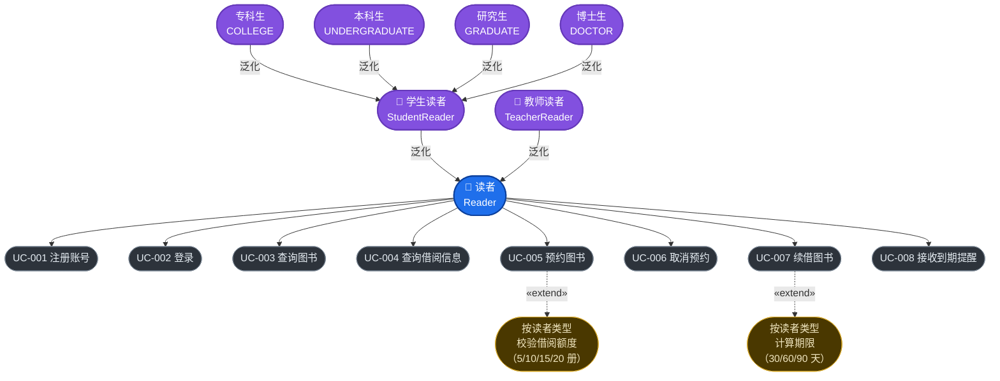
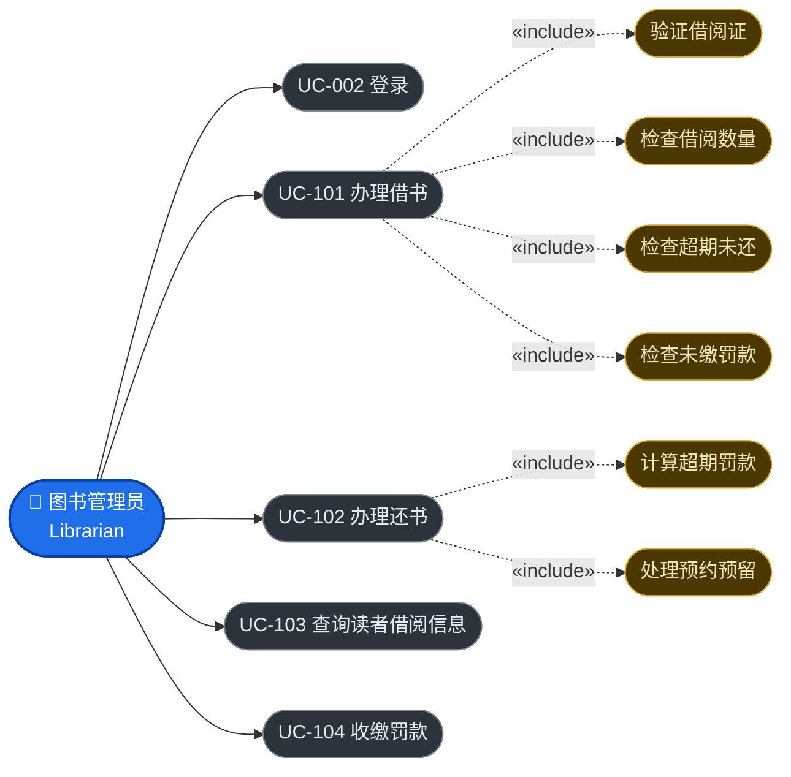
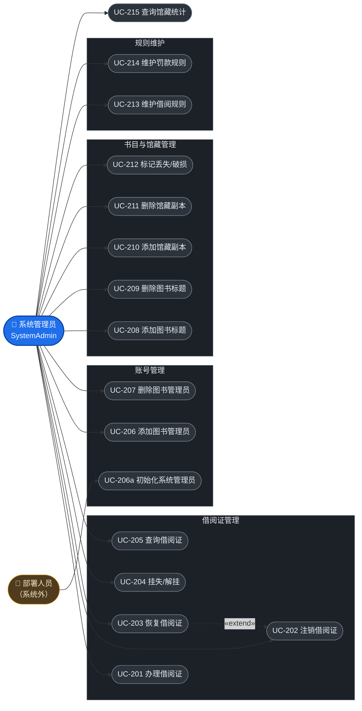
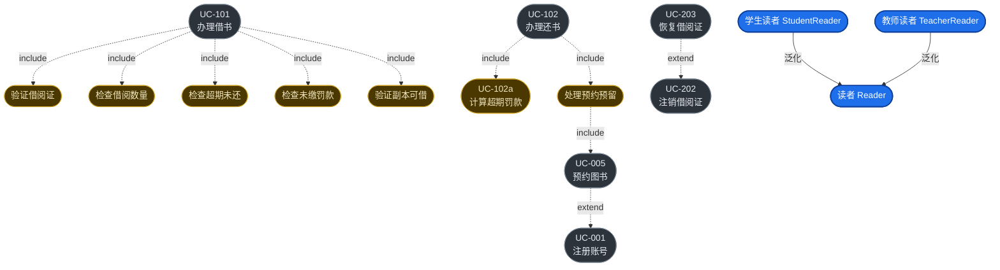

# 用例图（Use Case Diagram）

> **文档编号**：`specs/04-use-case-model.md`
> **制定依据**：`03-use-cases.md`
> **版本**：v1.0
> **日期**：2026-09-19
>
> **建模工具说明**：本项目采用 **Mermaid** 而非实验文档推荐的 PlantUML。
> 选型理由：Mermaid 零依赖（无需 Java 与 Graphviz 环境），可直接在 Markdown 编辑器中预览与渲染，便于人工审查与 Git 版本管理。
> 两种工具均满足实验文档"UML-as-Spec：图必须为文本格式并纳入 Git"的要求。
>
> 本文件共 5 张图：① 全景用例图、② 读者用例图、③ 图书管理员用例图、④ 系统管理员用例图、⑤ 用例关系图。

---

## 图 1：系统全景用例图

```mermaid
graph LR
    %% ===== 参与者 =====
    Reader(["👤 读者<br/>Reader"])
    Librarian(["👤 图书管理员<br/>Librarian"])
    Admin(["👤 系统管理员<br/>SystemAdmin"])

    %% ===== 读者用例 =====
    UC001(["UC-001<br/>注册账号"])
    UC002(["UC-002<br/>登录"])
    UC003(["UC-003<br/>查询图书"])
    UC004(["UC-004<br/>查询借阅信息"])
    UC005(["UC-005<br/>预约图书"])
    UC006(["UC-006<br/>取消预约"])
    UC007(["UC-007<br/>续借图书"])
    UC008(["UC-008<br/>接收到期提醒"])

    %% ===== 图书管理员用例 =====
    UC101(["UC-101<br/>办理借书"])
    UC102(["UC-102<br/>办理还书"])
    UC103(["UC-103<br/>查询读者借阅信息"])
    UC104(["UC-104<br/>收缴罚款"])

    %% ===== 系统管理员用例 =====
    UC201(["UC-201<br/>办理借阅证"])
    UC202(["UC-202<br/>注销借阅证"])
    UC203(["UC-203<br/>恢复借阅证"])
    UC204(["UC-204<br/>挂失/解挂借阅证"])
    UC205(["UC-205<br/>查询借阅证信息"])
    UC206(["UC-206<br/>添加图书管理员"])
    UC207(["UC-207<br/>删除图书管理员"])
    UC208(["UC-208<br/>添加图书标题"])
    UC209(["UC-209<br/>删除图书标题"])
    UC210(["UC-210<br/>添加馆藏副本"])
    UC211(["UC-211<br/>删除馆藏副本"])
    UC212(["UC-212<br/>标记副本丢失/破损"])
    UC213(["UC-213<br/>维护借阅规则"])
    UC214(["UC-214<br/>维护罚款规则"])
    UC215(["UC-215<br/>查询馆藏统计"])

    %% ===== 内部用例 =====
    UC102a(["UC-102a<br/>计算超期罚款"])

    %% ===== 读者关联 =====
    Reader --> UC001
    Reader --> UC002
    Reader --> UC003
    Reader --> UC004
    Reader --> UC005
    Reader --> UC006
    Reader --> UC007
    Reader --> UC008

    %% ===== 图书管理员关联 =====
    Librarian --> UC002
    Librarian --> UC101
    Librarian --> UC102
    Librarian --> UC103
    Librarian --> UC104

    %% ===== 系统管理员关联 =====
    Admin --> UC002
    Admin --> UC201
    Admin --> UC202
    Admin --> UC203
    Admin --> UC204
    Admin --> UC205
    Admin --> UC206
    Admin --> UC207
    Admin --> UC208
    Admin --> UC209
    Admin --> UC210
    Admin --> UC211
    Admin --> UC212
    Admin --> UC213
    Admin --> UC214
    Admin --> UC215

    %% ===== include 关系 =====
    UC101 -.->|&laquo;include&raquo;| UC102a
    UC102 -.->|&laquo;include&raquo;| UC102a

    %% ===== extend 关系 =====
    UC203 -.->|&laquo;extend&raquo;| UC202

    %% ===== 样式 =====
    classDef actor fill:#1f6feb,stroke:#0d419d,stroke-width:2px,color:#ffffff
    classDef usecase fill:#2d333b,stroke:#768390,stroke-width:1px,color:#e6edf3
    classDef inner fill:#4a3800,stroke:#d4a72c,stroke-width:2px,color:#f0e6c0

    class Reader,Librarian,Admin actor
    class UC001,UC002,UC003,UC004,UC005,UC006,UC007,UC008,UC101,UC102,UC103,UC104,UC201,UC202,UC203,UC204,UC205,UC206,UC207,UC208,UC209,UC210,UC211,UC212,UC213,UC214,UC215 usecase
    class UC102a inner
```

---

## 图 2：读者用例图（含参与者泛化）

> 体现 `StudentReader` 与 `TeacherReader` 泛化自 `Reader` 的继承关系。

---

## 图 3：图书管理员用例图

---

## 图 4：系统管理员用例图

---

## 图 5：核心用例关系图（include / extend / 泛化）

> 单独展示用例之间的依赖关系，便于审查关系建模的正确性。

---

## 关系说明

### include 关系（包含）

表示被包含用例是主用例**必需**的一步，每次执行主用例都会执行被包含用例。

| 主用例 | 被包含用例 | 说明 |
|---|---|---|
| UC-101 办理借书 | 验证借阅证 | 借书前必须校验借阅证有效 |
| UC-101 办理借书 | 检查借阅数量 | 必须检查是否超出该读者类型的额度 |
| UC-101 办理借书 | 检查超期未还 | 有超期未还则禁止借书 |
| UC-101 办理借书 | 检查未缴罚款 | 有欠款则禁止借书 |
| UC-101 办理借书 | 验证副本可借 | 必须确认副本状态为 `AVAILABLE` |
| UC-102 办理还书 | UC-102a 计算超期罚款 | 还书时必须判定是否超期并计罚 |
| UC-102 办理还书 | 处理预约预留 | 还书时必须检查预约队列并决定副本去向 |

### extend 关系（扩展）

表示被扩展用例在**特定条件**下才会执行，是可选行为。

| 扩展用例 | 被扩展用例 | 触发条件 |
|---|---|---|
| UC-203 恢复借阅证 | UC-202 注销借阅证 | 仅当读者反悔、需要恢复已注销的借阅证时执行 |
| UC-005 预约图书 | UC-001 注册账号 | 预约前需已注册并办证；未办证时触发办证流程 |

### 泛化关系（继承）

| 子类型 | 父类型 | 说明 |
|---|---|---|
| StudentReader 学生读者 | Reader 读者 | 借阅额度依具体学历类型而定（5/10/15 册） |
| TeacherReader 教师读者 | Reader 读者 | 借阅额度最高（20 册 / 90 天） |
| 专科生 / 本科生 / 研究生 / 博士生 | StudentReader | 具体读者类型，各自对应不同额度 |

### 参与者—用例关联

| 参与者 | 可执行的用例 |
|---|---|
| 读者 Reader | UC-001、UC-002、UC-003、UC-004、UC-005、UC-006、UC-007、UC-008 |
| 图书管理员 Librarian | UC-002、UC-101、UC-102、UC-103、UC-104 |
| 系统管理员 SystemAdmin | UC-002、UC-201 ~ UC-215（全部管理类用例） |
| 部署人员 Deployer | UC-206a |

---

## 与实验文档要求的对照

| 实验文档要求 | 本文件体现情况 |
|---|---|
| 参与者至少包括 Reader、Student、Teacher、Librarian、SystemAdmin | ✅ 图 2 完整展示 |
| Student 与 Teacher 泛化自 Reader | ✅ 图 2、图 5 中以泛化箭头体现 |
| 用例至少包括注册账号 | ✅ UC-001 |
| 用例至少包括查询图书 | ✅ UC-003 |
| 用例至少包括预约图书 | ✅ UC-005 |
| 用例至少包括查询借阅信息 | ✅ UC-004、UC-103 |
| 用例至少包括办理借书 | ✅ UC-101 |
| 用例至少包括办理还书 | ✅ UC-102 |
| 用例至少包括办理借阅证 | ✅ UC-201 |
| 用例至少包括添加图书 | ✅ UC-208（标题）、UC-210（副本） |
| 用例至少包括删除图书 | ✅ UC-209（标题）、UC-211（副本） |
| 用例至少包括维护规则 | ✅ UC-213、UC-214 |
| 准确表达 include、extend 或泛化关系 | ✅ 图 5 专门展示三类关系 |

**覆盖情况**：实验文档要求的 12 项参与者与用例全部覆盖，并额外补充了 19 个用例。

---

## 变更记录

| 版本 | 日期 | 变更内容 | 变更人 |
|---|---|---|---|
| v1.0 | 2026-09-19 | 初版制定。5 张 Mermaid 用例图。 | Agent 起草 |
