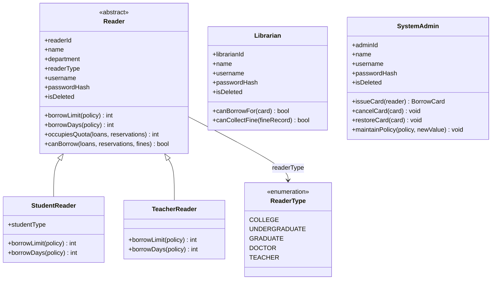
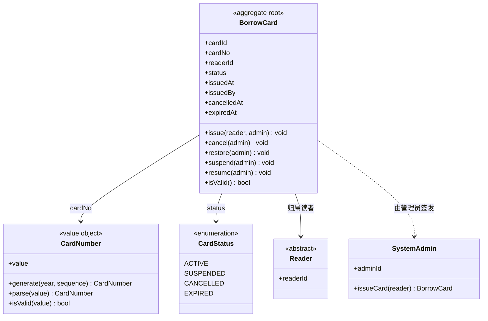
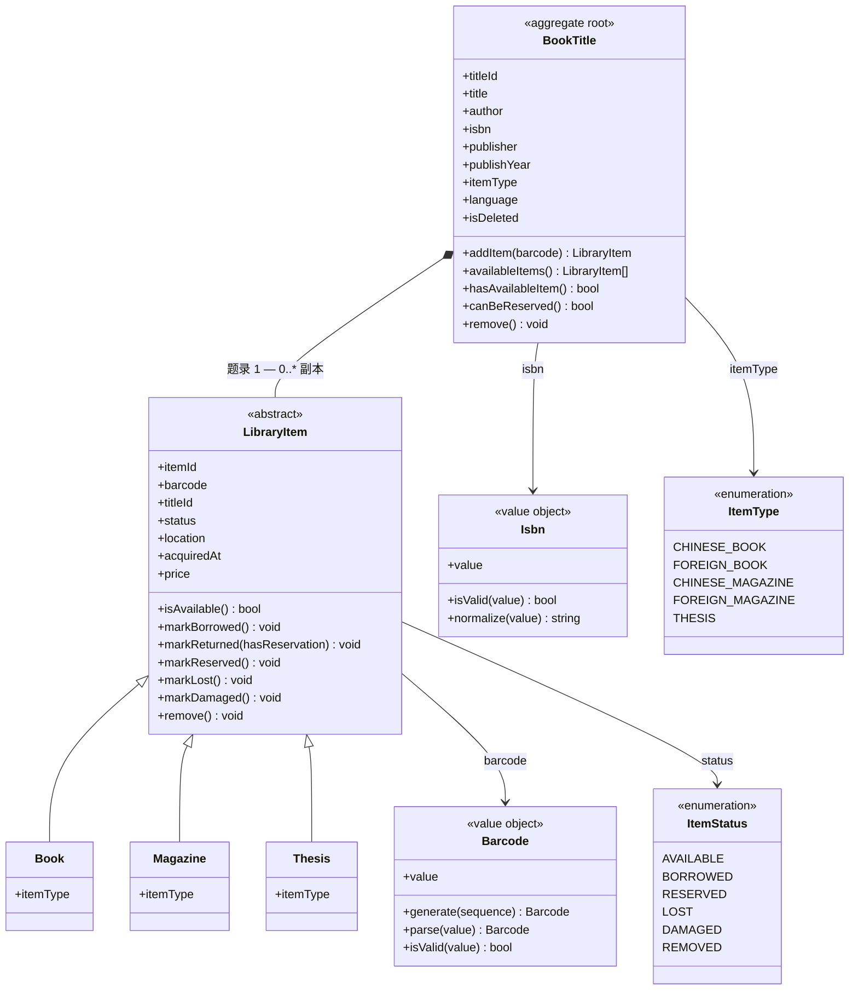
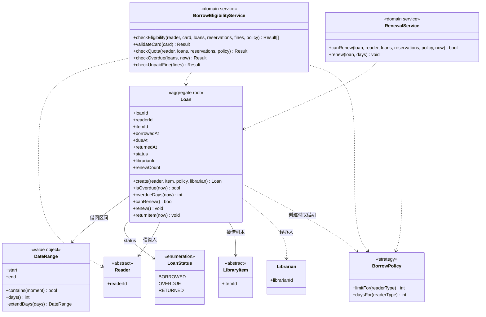
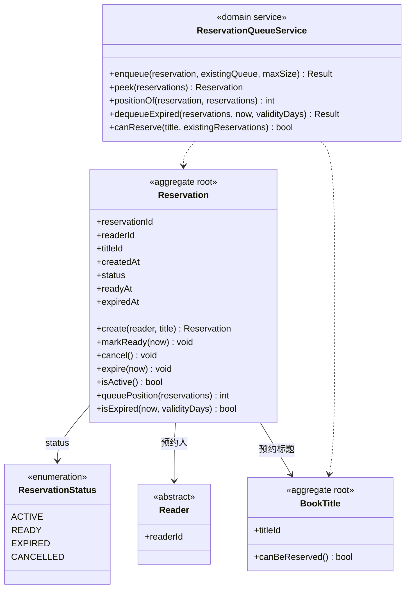
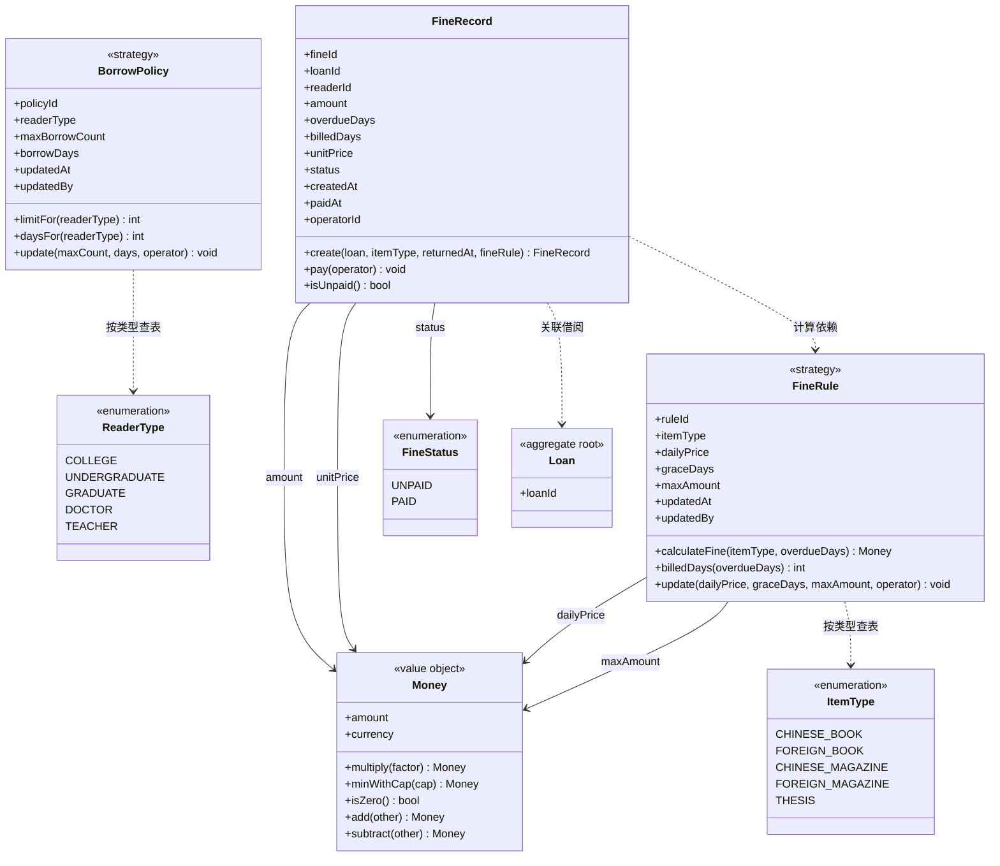
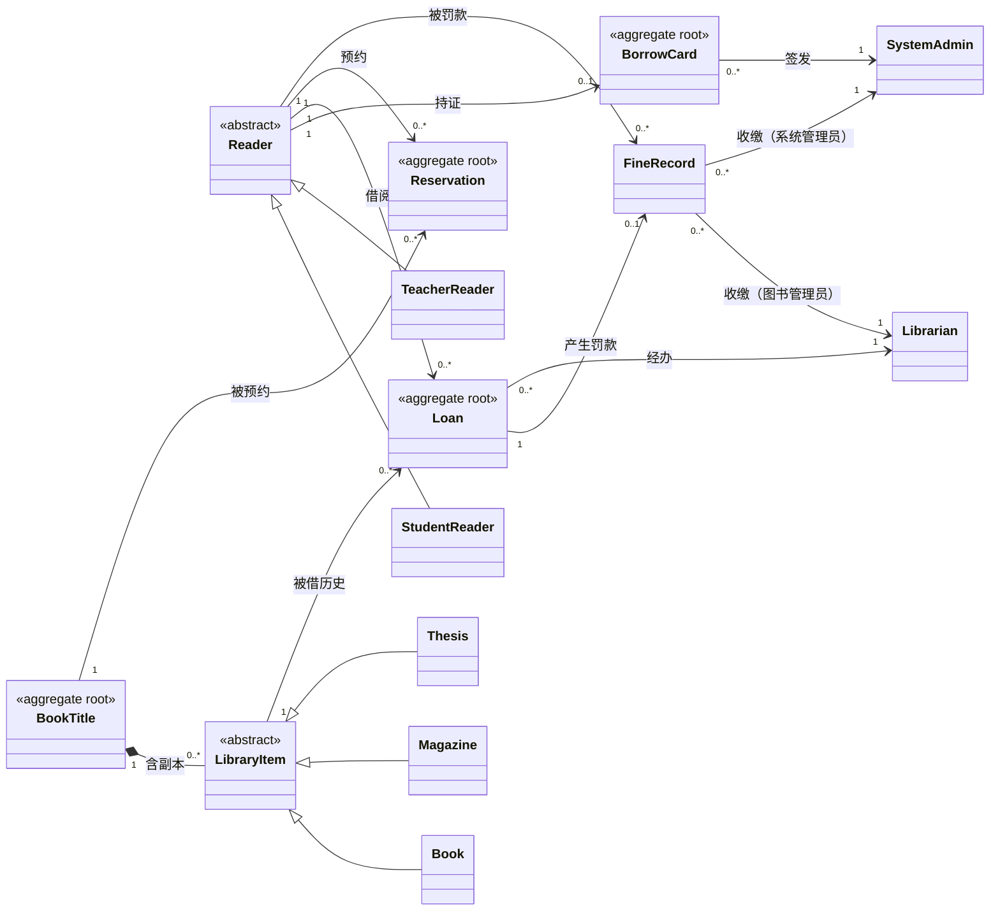

# 领域类图（Domain Class Diagram）

> **文档编号**：`specs/06-domain-class-diagram.md`
> **制定依据**：`05-domain-model.md`、`02-requirements.md`
> **版本**：v1.0
> **日期**：2026-09-19
>
> 本文件以 **UML 类图**的形式呈现 `05-domain-model.md` 定义的领域模型。类图是规格的一部分，随 Git 版本管理（宪法原则 3：UML-as-Spec）。
>
> **绘图工具说明**：实验文档推荐 PlantUML，本项目改用 **Mermaid**（`classDiagram`），理由见 `04-use-case-model.md` 开头的选型说明——零依赖、Markdown 插件直接预览、同样满足 UML-as-Spec 要求。
>
> **范围界定**：本图**只包含领域层**（实体、值对象、领域服务、策略对象），**不含** Controller、Repository、DTO、ORM 映射等设计/实现元素。那些属于 `09-design-model.md`。

---

## 1. 类图阅读指南

### 1.1 本图使用的 UML 记号

| 记号 | Mermaid 语法 | 含义 |
|---|---|---|
| `A <|-- B` | 实线空心三角 | **泛化/继承**（B 继承 A） |
| `A *-- B` | 实心菱形 | **组合**（A 是整体，B 是部分，同生命周期） |
| `A o-- B` | 空心菱形 | **聚合**（A 持有 B，B 可独立存在） |
| `A --> B` | 实线箭头 | **关联/导航**（A 知道 B） |
| `A ..> B` | 虚线箭头 | **依赖**（A 在方法中临时使用 B） |
| `+` / `-` | 前缀 | public / private |
| `$` | 前缀 | static |

### 1.2 领域层的立体分类

本系统领域对象分为四类，在图中用不同方式标识：

| 类别 | 图中标识 | 数量 | 特征 |
|---|---|---|---|
| **实体** | 普通类，部分标注「聚合根」 | 11 | 有唯一标识，标识在其生命周期内不变 |
| **值对象/枚举** | `<<value object>>` / `<<enumeration>>` 构造型 | 13 | 无标识，由属性值定义相等性，不可变 |
| **领域服务** | `<<domain service>>` 构造型 | 3 | 无状态，承载跨实体的业务规则 |
| **策略对象** | `<<strategy>>` 构造型 | 2 | 可替换的规则集合（Strategy 模式领域侧） |

### 1.3 图的分册策略

完整领域模型含 31 个对象，单张图会难以阅读。本文件按 **限界上下文模块** 拆为 6 张模块图，另加 1 张全局总览图，共 7 张：

| 图号 | 内容 | 对应领域模型章节 |
|:---:|---|---|
| 图 1 | 读者与账号模块 | §2 |
| 图 2 | 借阅证模块 | §3 |
| 图 3 | 书目与馆藏模块 | §4 |
| 图 4 | 流通模块 | §5 |
| 图 5 | 预约模块 | §6 |
| 图 6 | 罚款与规则模块 | §7、§8 |
| 图 7 | 全局总览（跨模块关系） | §9 |

---

## 2. 图 1：读者与账号模块（reader）

**图的职责**：展示读者继承体系与两类员工账号。

**关键设计**：

- `Reader` 是**抽象类**，不可直接实例化。
- `StudentReader` 与 `TeacherReader` **覆写** `borrowLimit()` 与 `borrowDays()` 两个模板方法，具体数值委托给 `BorrowPolicy` 查询——这是 **Strategy 模式**在领域侧的落点。
- `Librarian` 与 `SystemAdmin` **不继承** `Reader`：它们没有借阅额度，不是"可借阅的自然人"，套用继承会引入无用属性（如 `borrowLimit`）。
- 三类账号**共享登录属性**（`username` / `passwordHash`），但本模型**不为它们抽公共基类**——因为除了"能登录"之外没有任何共同业务行为，抽出 `Account` 基类会形成贫血抽象。



**图 1 说明**：

- `ReaderType` 五个取值与 `BorrowPolicy` 的五条规则一一对应。
- `StudentReader.studentType` 复用 `ReaderType` 的前四个取值（`COLLEGE`/`UNDERGRADUATE`/`GRADUATE`/`DOCTOR`）；`TeacherReader` 对应 `TEACHER`。
- `SystemAdmin.maintainPolicy()` 是「维护借阅规则和罚款规则」用例（UC-213/UC-214）的领域侧入口。

---

## 3. 图 2：借阅证模块（card）

**图的职责**：展示借阅证实体、证号值对象与状态枚举。

**关键设计**：

- `BorrowCard` 是**聚合根**：证号、状态、签发信息必须在同一事务内一致。
- `CardNumber` 作为**值对象**封装格式校验（正则 `^CARD\d{4}\d{6}$`）与生成逻辑，避免格式知识散落各处。
- 状态流转（`ACTIVE` ⇄ `SUSPENDED` → `CANCELLED` → `ACTIVE`）由实体自身的 `issue()` / `cancel()` / `restore()` / `suspend()` / `resume()` 方法守卫，**不允许外部直接改 `status` 字段**。



**图 2 说明**：

- `BorrowCard` * — 1 `Reader`：一个读者最多一张**有效**证（`ACTIVE`/`SUSPENDED`），`CANCELLED` 不计入（BR-003）。
- `expiredAt` 字段保留但当前**不校验**（BR-005），对应 `CardStatus.EXPIRED` 亦保留不用。
- 证号示例：`CARD2026000001`（4 位年份 + 6 位递增序号）。

---

## 4. 图 3：书目与馆藏模块（catalog）

**图的职责**：展示「题录—副本」两层结构与借出物类型继承。

**关键设计（本系统核心建模决策）**：

- **`BookTitle` vs `LibraryItem` 的分离**：`BookTitle` 是**题录信息**（"《算法导论》这本书"），`LibraryItem` 是**物理副本**（"编号 BC00000001 的那一本"）。预约（UC-005）针对**标题**，借出（UC-101）针对**副本**——不分离这两层，预约逻辑无法表达。
- `BookTitle` 1 — 0..* `LibraryItem` 用**组合**（实心菱形）：副本脱离标题无业务意义。
- `LibraryItem` 的继承（`Book`/`Magazine`/`Thesis`）**在领域层保留**语义，但**持久化层用单表继承**（决策 D-50）——`library_items` 表加 `itemType` 判别字段，不拆表。
- 子类**不硬编码**罚款差异，罚款单价由 `FineRule` 按 `itemType` 查表决定。



**图 3 说明**：

- 仅 `AVAILABLE` 状态可借出（BR-033）；`BORROWED` 状态不可直接删除，须先归还（BR-034）。
- `markReturned(hasReservation)` 是预约预留的落点：有预约则副本置 `RESERVED`，同时队首预约置 `READY`。
- 题录允许在**无任何副本**的状态下存在（BR-014）。
- 同一表 `Book`/`Magazine` 各含中外文两种 `itemType` 取值，故子类无额外属性，仅承担语义分类。

---

## 5. 图 4：流通模块（circulation）

**图的职责**：展示借阅记录实体、时间区间值对象，以及两个领域服务。

**关键设计**：

- `Loan` 是**聚合根**：借出、续借、归还的状态变更必须原子化。
- `DateRange` 作为**不可变值对象**：`extendDays()` 返回**新对象**而非修改自身——这让续借操作天然可重放、可测试。
- **`BorrowEligibilityService` 为何是领域服务而非实体方法**：借阅资格判定需同时访问 `Reader`、`BorrowCard`、`Loan`、`Reservation`、`FineRecord` 五类对象。放进任何单一实体都会造成职责错位（`Reader` 不应当知道 `BorrowCard` 的内部结构），并引发为判定而加载整张对象图的问题。
- `BorrowEligibilityService` 是**纯函数式**的：只判定、不改状态。校验顺序**固定**为「权限 → 借阅证 → 数量 → 超期 → 罚款 → 副本」，该顺序决定了失败时返回哪个错误码。
- `LoanStatus.OVERDUE` 是**派生状态**（由 `dueAt` 与当前时刻实时判定），持久化层可仅存 `BORROWED`/`RETURNED`；领域层保留它以便业务表达与测试断言。



**图 4 说明**：

- 续借约束（BR-015 ~ BR-019）：最多 2 次、每次 +7 天、已超期不可续、**存在预约不影响续借**、续借不额外占额度。
- `create()` 在借出时刻**快照** `dueAt`——这是"规则修改不追溯已有借阅"（BR-050）的实现基础。
- `renewCount` 取值范围 0-2，是续借次数的唯一真源。

---

## 6. 图 5：预约模块（reservation）

**图的职责**：展示预约实体与队列管理领域服务。

**关键设计**：

- `Reservation` 是**聚合根**，指向 `BookTitle`（不是副本）。
- 排队顺序由 `createdAt` 升序决定（BR-021），**不依赖自增主键**——自增主键在不同并发路径下可能乱序。
- `ReservationQueueService` 负责队列语义：入队上限校验、队首识别、失效清理与顺延。
- 有效期 7 天（BR-025）：`ACTIVE` 自 `createdAt` 起算，`READY` 自 `readyAt` 起算——**两种状态两个起算点**，这是容易实现错的地方。



**图 5 说明**：

- 同一读者对同一标题**不得**存在多个有效预约（BR-023）。
- 每个标题队列上限 **5 人**（BR-022）。
- 仅当标题下**所有副本均不可借**时才可预约（BR-020）。
- 有效预约（`ACTIVE`/`READY`）占用 1 个借阅额度，取消或失效后释放（BR-026）——这是"额度 = 未归还借阅 + 有效预约"口径的一半。
- 队列的并发安全由**应用层事务**保证，领域服务本身不处理锁。

---

## 7. 图 6：罚款与规则模块（fine + policy）

**图的职责**：展示罚款记录实体、金额值对象，以及两个策略对象。

**关键设计**：

- `Money` 值对象内部用 **`Decimal`**（`quantize(0.01)`），**禁止 `float`**——这是 `02-requirements.md` 中 Q-04 发现的精度问题（`0.20 × 3 = 0.6000000000000001`）的解决方案。
- `BorrowPolicy` 与 `FineRule` 都是 **Strategy 模式的落点**：读者类型差异与借出物类型差异通过**查表**体现，而非在代码中写 `if readerType == ...` 分支。规则存数据库、可在线维护（BR-049，对应决策 D-47a）。
- `FineRecord` 保存 `unitPrice` 作为**计算时快照**，因此规则修改**不追溯**已生成的罚款（BR-050）。
- `FineRecord` 1 — 1 `Loan`：一条借阅记录最多产生一条罚款，罚款在还书时**一次性计算**（BR-029）。



**图 6 说明**：

**罚款计算规则**：

```
billedDays = max(overdueDays - graceDays, 0)
amount     = min(billedDays × dailyPrice, maxAmount)
```

**`BorrowPolicy` 初始数据**：

| readerType | maxBorrowCount | borrowDays |
|---|---:|---:|
| `COLLEGE` | 5 | 30 |
| `UNDERGRADUATE` | 5 | 30 |
| `GRADUATE` | 10 | 60 |
| `DOCTOR` | 15 | 90 |
| `TEACHER` | 20 | 90 |

**`FineRule` 初始数据**：

| itemType | dailyPrice | graceDays | maxAmount |
|---|---:|---:|---:|
| `CHINESE_BOOK` | 0.20 | 2 | 100.00 |
| `FOREIGN_BOOK` | 0.50 | 2 | 100.00 |
| `CHINESE_MAGAZINE` | 0.10 | 2 | 100.00 |
| `FOREIGN_MAGAZINE` | 0.20 | 2 | 100.00 |
| `THESIS` | 1.00 | 2 | 100.00 |

---

## 8. 图 7：全局总览（跨模块关系）

**图的职责**：一张图看清 14 个实体之间的核心关联，省略属性与方法，只保留关系与多重性。

> 本图为**关系索引**，属性与方法见前述各分模块图。



---

## 9. 关系汇总表

> 与 `05-domain-model.md` §9 保持一致，此处以 UML 术语表述。

### 9.1 泛化（Generalization）

| 子类 | 父类 | 覆写内容 |
|---|---|---|
| `StudentReader` | `Reader` | `borrowLimit()`、`borrowDays()` |
| `TeacherReader` | `Reader` | `borrowLimit()`、`borrowDays()` |
| `Book` | `LibraryItem` | 无（仅语义分类） |
| `Magazine` | `LibraryItem` | 无（仅语义分类） |
| `Thesis` | `LibraryItem` | 无（仅语义分类） |

### 9.2 组合（Composition）

| 整体 | 部分 | 多重性 | 说明 |
|---|---|---|---|
| `BookTitle` | `LibraryItem` | 1 — 0..* | 副本脱离题录无业务意义；题录软删除时副本同步置 `REMOVED`（BR-042） |

### 9.3 关联（Association）

| 源 | 目标 | 多重性 | 说明 |
|---|---|---|---|
| `Reader` | `BorrowCard` | 1 — 0..1 | 最多一张**有效**证 |
| `Reader` | `Loan` | 1 — 0..* | 借阅记录 |
| `Reader` | `Reservation` | 1 — 0..* | 预约记录 |
| `Reader` | `FineRecord` | 1 — 0..* | 罚款记录 |
| `BookTitle` | `Reservation` | 1 — 0..* | 预约队列 |
| `LibraryItem` | `Loan` | 1 — 0..* | 历史借阅 |
| `Loan` | `FineRecord` | 1 — 0..1 | 最多一条罚款 |
| `Loan` | `Librarian` | * — 1 | 经办人 |
| `BorrowCard` | `SystemAdmin` | * — 1 | 签发人 |
| `FineRecord` | `Librarian` / `SystemAdmin` | * — 1 | 收缴人 |

### 9.4 依赖（Dependency）

| 使用方 | 被使用方 | 用途 |
|---|---|---|
| `BorrowEligibilityService` | `BorrowPolicy`、`Reader`、`Loan`、`BorrowCard`、`Reservation`、`FineRecord` | 借阅资格综合判定 |
| `RenewalService` | `Loan`、`Reader`、`Reservation`、`BorrowPolicy` | 续借资格判定 |
| `ReservationQueueService` | `Reservation`、`BookTitle` | 队列管理 |
| `Loan` | `BorrowPolicy` | 创建时取借期，快照 `dueAt` |
| `FineRecord` | `FineRule` | 罚款金额计算 |

### 9.5 依赖注入方向

图中所有 `..>` 依赖均指向**抽象或策略对象**，不指向具体实现：

- 领域服务依赖 `BorrowPolicy` / `FineRule` 的**查询接口**，不依赖具体存储方式。
- `Loan.create()` 接收 `policy` 参数而非自行查询——便于单元测试时注入测试规则。

这满足宪法原则 5（分层架构）与原则 8（业务规则集中）。

---

## 10. 建模决策说明

> 记录图中几处**非显然**的设计取舍，供人工审查时质询。

### 10.1 为什么 `BookTitle` 与 `LibraryItem` 要分成两个类？

因为业务上它们是两回事：

| 场景 | 操作对象 |
|---|---|
| 预约图书（UC-005） | **题录** —— "我要借《算法导论》，不管哪本" |
| 办理借书（UC-101） | **副本** —— "递过来的是 BC00000001 这本" |
| 查询可借性（UC-003） | **题录** —— "这本书还有没有可借的？" |
| 还书（UC-102） | **副本** —— "刷的是 BC00000001 这个条码" |
| 计算罚款（UC-102a） | **副本** —— 罚款单价挂在 `ItemType` 上，是副本的属性 |

若合并成一个类，则"预约"必须记 `item_id`，但预约时并不知道会被哪个副本满足——模型会失真。

### 10.2 为什么 `Librarian` / `SystemAdmin` 不继承 `Reader`？

`Reader` 的核心职责是**承载借阅资格与额度**。员工账号没有借阅额度（`Librarian` 无 `borrowLimit` 语义），继承会带来：

- 无用属性：`borrowLimit()`、`occupiesQuota()`
- 违反里氏替换：`Librarian` 无法替代 `Reader` 参与借阅判定

它们的共同点仅有"能登录"，不足以构成继承关系。**登录是应用层关注点，不是领域继承理由。**

### 10.3 为什么 `LoanStatus.OVERDUE` 保留为派生状态？

持久化层只需 `BORROWED` / `RETURNED` 两态（`OVERDUE` 由 `dueAt` 与当前时刻推定），但领域层保留 `OVERDUE`：

- 业务语言中有"超期"这个概念，测试也需要断言它
- 若领域层也去掉，`isOverdue()` 会变成到处散落的 `now > dueAt` 判断
- 代价：需在 `05-domain-model.md` 明确标注它是**派生**的，避免实现者误以为要持久化

### 10.4 为什么规则用策略对象而非 `if/else`？

实验要求实现「维护借阅规则和罚款规则」用例（UC-213/UC-214）。若规则写死在代码中：

- 该用例**无法真实实现**（改了规则需要改代码 + 重启 + 重新部署）
- 修改会违反宪法原则 8（业务规则集中）

因此 `BorrowPolicy` / `FineRule` **必须存数据库**（BR-049，决策 D-47a），领域侧以查表方法暴露。

### 10.5 为什么金额用 `Money` 值对象而不是 `Decimal` 裸字段？

- 统一精度约束（`quantize(0.01)`）与币种（`CNY`）
- 把"封顶比较"（`minWithCap`）等业务运算收到值对象内部
- 防止有人图省事写成 `float`——**类型系统层面的防御**

---

## 11. 与实验文档要求的对照

> 对照实验一第十三节及第十二节的建模要求，逐项验证。

| 实验文档要求 | 对应图 | 覆盖情况 |
|---|---|---|
| 类图须含 `Reader`、`StudentReader`、`TeacherReader` | 图 1 | ✅ 含继承关系 |
| 类图须含 `BorrowCard` | 图 2 | ✅ 含 `CardNumber`、`CardStatus` |
| 类图须含 `BookTitle` 与馆藏副本 | 图 3 | ✅ 两层分离 |
| 类图须含 `Book` / `Magazine` / `Thesis` | 图 3 | ✅ 三重继承 |
| 类图须含 `Loan` | 图 4 | ✅ 含 `DateRange`、`LoanStatus` |
| 类图须含 `Reservation` | 图 5 | ✅ 含队列服务 |
| 类图须含 `BorrowPolicy` | 图 6 | ✅ 标注 `<<strategy>>` |
| 类图须含 `FineRule` | 图 6 | ✅ 标注 `<<strategy>>` |
| 类图须含 `FineRecord` | 图 6 | ✅ 含 `Money` 值对象 |
| 须体现继承关系 | 图 1、图 3、图 7 | ✅ Reader 体系 + LibraryItem 体系 |
| 须体现关联与多重性 | 图 7 + §9.3 | ✅ 10 条关联均标注多重性 |
| 须区分实体与值对象 | 全图 | ✅ 构造型标注 |
| 借阅规则须抽象为策略 | 图 4、图 6 | ✅ `BorrowPolicy` |
| 罚款规则须抽象为策略 | 图 6 | ✅ `FineRule` |
| 领域服务须体现 | 图 4、图 5 | ✅ 3 个领域服务 |
| **不得**出现 Controller / Repository / DTO | 全图 | ✅ 本图仅含领域概念 |

---

## 12. 变更记录

| 版本 | 日期 | 变更内容 | 变更人 |
|---|---|---|---|
| v1.0 | 2026-09-19 | 初版制定。7 张 Mermaid 类图，覆盖 14 实体 / 12 值对象 / 3 领域服务 / 2 策略对象；含 5 处建模决策说明。 | Agent 起草 |
| v1.1 | 2026-09-19 | ① 修正对象计数（v1.0 误写 11 实体 / 13 值对象 / 29 对象，实际 14 / 12 / 31）；② 修正 §1.3 分册图数表述（6 → 6 张模块图 + 1 张总览图）；③ 图 7 补 `FineRecord → SystemAdmin` 收缴关系，与 §9.3 表格保持一致。 | Agent 自检后修订 |
