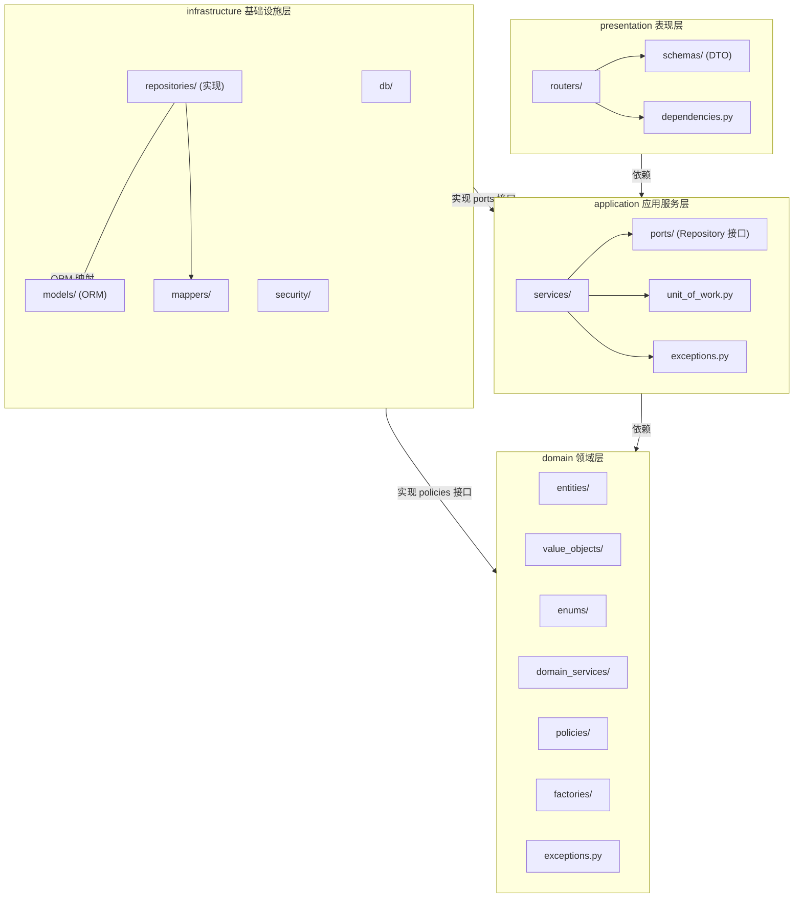
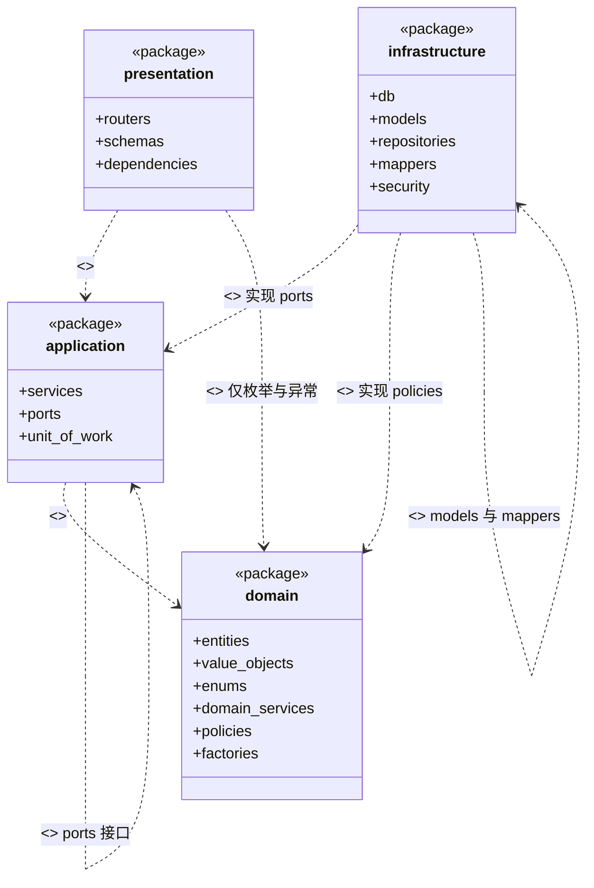
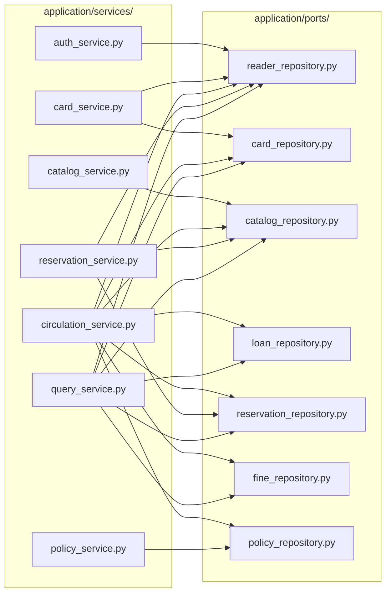
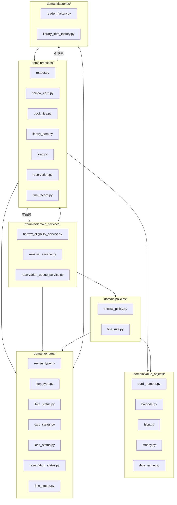
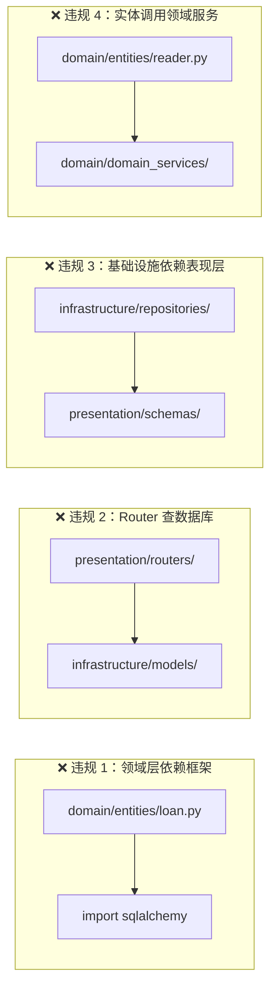
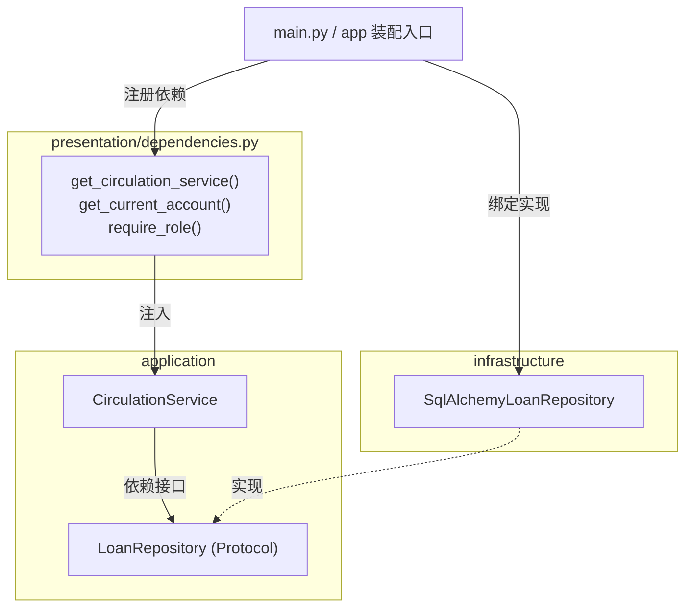

# 包图（Package Diagram）

> **文档编号**：`specs/08-package-diagram.md`
> **制定依据**：`constitution.md`（第五、六条）、`07-architecture.md`、`05-domain-model.md`
> **版本**：v1.0
> **日期**：2026-09-19
>
> 本文件以 **UML 包图**呈现系统的包结构与包间依赖。包图的核心价值不是"画目录树"——那是文件浏览器就能做的事——而是**把依赖规则固化为可审查的约束**。
>
> **建模工具**：Mermaid（`graph`）而非 PlantUML，理由见 `04-use-case-model.md` 开头的选型说明。UML 包图惯用「文件夹图标 + 虚线箭头」表示依赖，Mermaid `graph` 无原生包图标，故本文件以**分组的子图（`subgraph`）表示包**，用**带标签的箭头表示依赖**，并补充 `classDiagram` 形式的包间依赖图以呈现 `<<import>>` / `<<access>>` 语义。

---

## 1. 两套视角与它们的映射

这是本文件首先要讲清楚的事，也是人工审查最容易被质疑的点。

系统有两套并存的划分方式，它们**不冲突**——是同一系统的两个正交切面：

| 视角 | 出处 | 划分依据 | 典型单元 |
|---|---|---|---|
| **业务视角** | `05-domain-model.md` §1.1 | 按**问题域**划分（限界上下文） | `reader`、`card`、`catalog`、`circulation`、`reservation`、`fine`、`policy` |
| **技术视角** | `07-architecture.md` §8 | 按**职责层次**划分 | `presentation`、`application`、`domain`、`infrastructure` |

**为什么不会冲突**：业务模块**横向切分问题空间**，技术分层**纵向切分职责**。真正落地时，业务模块在每一层都有自己的落点。

**映射矩阵**（行 = 业务模块，列 = 技术层）：

| 业务模块 | 表现层 | 应用层 | 领域层 | 基础设施层 |
|---|---|---|---|---|
| `reader` | `auth_router` | `AuthService` | `Reader`、`StudentReader`、`TeacherReader`、`Librarian`、`SystemAdmin`、`ReaderType` | `reader_model`、`reader_repository` |
| `card` | `card_router` | `CardService` | `BorrowCard`、`CardNumber`、`CardStatus` | `card_model`、`card_repository` |
| `catalog` | `catalog_router` | `CatalogService` | `BookTitle`、`LibraryItem`、`Book`、`Magazine`、`Thesis`、`Barcode`、`Isbn`、`ItemType`、`ItemStatus` | `catalog_model`、`catalog_repository` |
| `circulation` | `circulation_router` | `CirculationService` | `Loan`、`DateRange`、`LoanStatus`、`BorrowEligibilityService`、`RenewalService` | `loan_model`、`loan_repository` |
| `reservation` | `reservation_router` | `ReservationService` | `Reservation`、`ReservationStatus`、`ReservationQueueService` | `reservation_model`、`reservation_repository` |
| `fine` | `circulation_router`（收缴） | `CirculationService`（收缴） | `FineRecord`、`Money`、`FineStatus` | `fine_model`、`fine_repository` |
| `policy` | `policy_router` | `PolicyService` | `BorrowPolicy`、`FineRule` | `policy_model`、`policy_repository` |
| 查询（跨模块） | `query_router` | `QueryService` | —（只读，不产生领域行为） | 各 repository |

**映射矩阵暴露的三处设计事实**：

1. **`fine` 模块在表现层与应用层没有独立包**。罚款的收缴动作（UC-104）发生在流通业务中，由 `CirculationService` 承载；罚款规则维护（UC-214）属规则范畴，由 `PolicyService` 承载。因为**罚款本身不是一个独立的用户操作入口**——它由还书自动触发，或由馆员在流通窗口收缴。
2. **`reader` 模块横跨认证与员工管理**。读者的登录注册（UC-001/002）与员工的账号管理（UC-206/207）都落在 `AuthService` 领域，但表现层分属 `auth_router` 与 `admin_router`。
3. **查询不产生领域行为**。`QueryService` 直接经 Repository 组装 DTO 返回，不经过领域层——因为纯查询不涉及业务规则判定。**这是有意为之**，不是漏设计。

---

## 2. 图 1：顶层包图

**图的职责**：呈现四层包、包间依赖方向，以及依赖倒置的反转点。



**依赖规则（可审查的硬约束）**：

| 编号 | 规则 | 检查方式 |
|---|---|---|
| R-1 | `presentation` 只能依赖 `application` 与 `domain` 的**枚举/异常**，不得依赖 `infrastructure` | grep `presentation/` 中 `infrastructure` → 0 命中 |
| R-2 | `application` 可以依赖 `domain`，不得依赖 `infrastructure` 具体类 | grep `application/` 中 `infrastructure` → 0 命中 |
| R-3 | `domain` **不得**依赖任何其他包 | grep `domain/` 中 `fastapi`、`sqlalchemy`、`application`、`infrastructure` → 0 命中 |
| R-4 | `infrastructure` 实现 `application/ports/` 与 `domain/policies/` 定义的接口 | 接口由上层定义，实现由下层提供 |
| R-5 | `infrastructure` 不得依赖 `presentation` | grep `infrastructure/` 中 `presentation` → 0 命中 |

**R-3 是可机械验证的**，也是整个架构最重要的约束。检验方法：删掉 `fastapi` 与 `sqlalchemy` 依赖后，`domain/` 下的代码应当仍能导入并跑通单元测试。

---

## 3. 图 2：包间依赖（UML 依赖语义）

**图的职责**：以 `classDiagram` 形式精确表达包间的依赖构造型，便于审查依赖方向。



**依赖方向汇总**：

| 源包 | 目标包 | 构造型 | 说明 |
|---|---|---|---|
| `presentation` | `application` | `<<import>>` | 调用应用服务 |
| `presentation` | `domain` | `<<access>>` | **仅**访问枚举与异常，不访问实体行为 |
| `application` | `domain` | `<<import>>` | 调用领域服务与实体方法 |
| `application` | `application` | `<<import>>` | `services` 依赖 `ports` 接口 |
| `infrastructure` | `application` | `<<realize>>` | 实现 Repository 接口 |
| `infrastructure` | `domain` | `<<realize>>` | 实现 Policy 的数据访问能力 |
| `infrastructure` | `infrastructure` | `<<import>>` | `repositories` 依赖 `models` 与 `mappers` |

**注意 `presentation → domain` 的 `<<access>>`**：表现层确实需要 `Role` 枚举（鉴权守卫用）和领域异常（异常处理器用）。如果要求表现层完全不碰领域层，就得在应用层再包一层等价枚举——那是无价值的重复。因此约束收紧为"**只能访问枚举与异常，不得访问实体**"。

---

## 4. 图 3：应用层内部包图

**图的职责**：展示应用服务与 Repository 接口（ports）的对应关系。



**这张图暴露的耦合事实**（供审查判断是否可接受）：

| 服务 | 依赖的 Repository 数 | 说明 |
|---|---:|---|
| `CirculationService` | **7（全部）** | 借书/还书是跨模块协调最多的操作：需读读者额度、验证、读副本状态、写借阅、处理预约队列、生成罚款、读规则 |
| `QueryService` | 6 | 查询本身就要跨模块组装数据 |
| `PolicyService` | 1 | 只碰规则表，内聚度最高 |
| `AuthService` | 1 | 只碰读者与员工账号 |
| `CardService` | 2 | 读者 + 借阅证 |
| `CatalogService` | 1 | 只碰书目馆藏 |
| `ReservationService` | 3 | 读者 + 题录 + 预约 |

**`CirculationService` 依赖 7 个 Repository 是否算坏味道？**

不算，但需要说明理由：还书这个操作在业务上**天然是跨模块的**——它同时改变借阅记录、副本状态、罚款记录、预约队列四项状态。这不是设计缺陷，而是业务事实。架构上正确的做法是**接受这个耦合集中在应用层**，而不是把它分散到多处。

**真正的风险**：`CirculationService` 会变成"上帝服务"。缓解措施是将**判定逻辑**（而非编排逻辑）全部下沉到领域层——`BorrowEligibilityService`、`RenewalService`、`ReservationQueueService`。这样 `CirculationService` 只剩下"取数据 → 调领域 → 落库"的编排骨架，虽然宽度大但深度浅。

**审查建议**：如果 `CirculationService` 的单个方法超过 50 行，说明编排逻辑过重，应考虑拆分为 `BorrowWorkflow` 与 `ReturnWorkflow` 两个协作对象。

---

## 5. 图 4：领域层内部包图

**图的职责**：展示领域层子包的依赖关系，验证领域层的自洽性。



**领域层内部的依赖规则**：

| 编号 | 规则 | 理由 |
|---|---|---|
| D-1 | `enums` 不依赖任何子包 | 枚举是叶子节点，是领域层最底层 |
| D-2 | `value_objects` 只依赖 `enums` | 值对象可引用枚举，但不引用实体 |
| D-3 | `entities` 依赖 `enums` 与 `value_objects` | 实体持有值对象与枚举属性 |
| D-4 | `domain_services` 依赖 `entities`、`enums`、`policies` | 领域服务需同时操作多个实体与规则 |
| D-5 | `policies` 依赖 `enums` 与 `value_objects`，**不依赖 `entities`** | 规则对象不应知道实体结构，只做数值查询与计算 |
| D-6 | `factories` 依赖 `entities` 与 `enums` | 工厂负责类型分派创建 |
| **D-7** | **`entities` 不依赖 `domain_services` 与 `factories`** | **关键约束**：实体不应主动调用领域服务，否则形成循环依赖 |

**D-7 为何是关键**：如果 `Reader.can_borrow()` 内部调用 `BorrowEligibilityService`，就会形成 `entities → domain_services → entities` 循环。正确做法是**由应用层协调**：应用层先调 `BorrowEligibilityService.check_eligibility()`，再调实体方法。

**D-5 的一个例外说明**：`BorrowPolicy.limit_for()` 被 `Reader.borrow_limit(policy)` 调用——传参方向是**实体 → 策略**，因此 `policies` 不需要反向依赖 `entities`。这是依赖倒置在领域层内部的应用。

---

## 6. 图 5：基础设施层内部包图

**图的职责**：展示 ORM 模型与领域实体的分离，以及 Mapper 的中介作用。

```mermaid
graph LR
    subgraph DB["infrastructure/db/"]
        G1["session.py"]
        G2["base.py"]
    end

    subgraph MODELS["infrastructure/models/  (ORM)"]
        M1["reader_model.py"]
        M2["card_model.py"]
        M3["catalog_model.py"]
        M4["loan_model.py"]
        M5["reservation_model.py"]
        M6["fine_model.py"]
        M7["policy_model.py"]
    end

    subgraph MAPPER["infrastructure/mappers/"]
        N1["reader_mapper.py"]
        N2["card_mapper.py"]
        N3["catalog_mapper.py"]
        N4["loan_mapper.py"]
        N5["reservation_mapper.py"]
        N6["fine_mapper.py"]
        N7["policy_mapper.py"]
    end

    subgraph REPO["infrastructure/repositories/"]
        O1["sqlalchemy_reader_repository.py"]
        O2["sqlalchemy_card_repository.py"]
        O3["sqlalchemy_catalog_repository.py"]
        O4["sqlalchemy_loan_repository.py"]
        O5["sqlalchemy_reservation_repository.py"]
        O6["sqlalchemy_fine_repository.py"]
        O7["sqlalchemy_policy_repository.py"]
    end

    subgraph SEC["infrastructure/security/"]
        Q1["jwt.py"]
        Q2["password.py"]
    end

    REPO --> MAPPER
    REPO --> MODELS
    REPO --> DB
    MAPPER --> MODELS
    MODELS --> DB
    SEC --> DB
```



**为什么需要两层对象（领域实体 + ORM 模型）**

这是本项目**为满足宪法第五条付出的明确代价**，值得单独说明：

| 方面 | 领域实体 | ORM 模型 |
|---|---|---|
| 关注点 | 业务规则与不变量 | 表结构与关系映射 |
| 内容 | `Loan.can_renew()`、`Loan.overdue_days()` 等行为 | `__tablename__`、`Column`、`relationship()` |
| 依赖 | 纯 Python | `sqlalchemy` |
| 可否单测 | 可以，无需数据库 | 需要数据库或 mock |

若采用 Active Record（领域实体直接带 ORM 映射），则：

- 领域层必须 `import sqlalchemy` → **违反宪法第五条**
- 领域实体的单元测试必须连数据库 → **违反宪法第十条精神**

因此 Mapper 层是这个约束的必然产物。7 组 Mapper 是**必要成本**，不是过度设计。

**Mapper 的实现形态**：

```python
# infrastructure/mappers/loan_mapper.py
class LoanMapper:
    @staticmethod
    def to_domain(model: LoanModel) -> Loan:
        return Loan(
            loan_id=model.loan_id,
            reader_id=model.reader_id,
            item_id=model.item_id,
            borrowed_at=model.borrowed_at,
            due_at=model.due_at,
            returned_at=model.returned_at,
            status=LoanStatus(model.status),
            librarian_id=model.librarian_id,
            renew_count=model.renew_count,
        )

    @staticmethod
    def to_model(loan: Loan, model: LoanModel | None = None) -> LoanModel:
        ...
```

---

## 7. 图 6：违规依赖示例与防线

**图的职责**：把宪法禁止的依赖路径画出来，作为代码审查的对照物。



**四类典型违规与其危害**：

| 违规 | 代码形态 | 危害 | 宪法条款 |
|---|---|---|---|
| **1. 领域层 import 框架** | 实体类标注 `__tablename__` 或 `Column()` | 领域逻辑无法脱离数据库测试；ORM 变更波及业务规则 | 第五条 |
| **2. Router 直接查库** | `db.query(...)` 出现在路由函数中 | 业务规则漏到表现层，无法被其他入口复用 | 第六条 |
| **3. 基础设施依赖表现层** | Repository 中 import Pydantic Schema | 依赖方向反转，形成环 | 第五条 |
| **4. 实体调用领域服务** | `Reader.can_borrow()` 内部 `new BorrowEligibilityService()` | 领域层内部循环依赖；实体无法独立实例化 | —（本文件 D-7） |

**防线设置**：

| 防线 | 手段 | 强度 |
|---|---|---|
| 编译期 | Python 无编译期检查，但可用 `import-linter` 配置契约 | 需额外工具 |
| 测试期 | 领域层单测**禁止**导入数据库 fixture；`tests/unit/` 下不得出现 `Session` | 强（测试失败即暴露） |
| 审查期 | grep 检查（见 §2 各 R 规则） | 中（依赖人工） |
| 文档期 | 本文件 §2、§5 的规则表作为审查清单 | 弱但必要 |

**推荐在实验二实现时执行的最小检查**：

```bash
# 领域层不得出现框架导入
grep -rn "sqlalchemy\|fastapi" backend/app/domain/ && echo "❌ 违规" || echo "✅ 通过"

# 表现层不得直接访问基础设施
grep -rn "infrastructure" backend/app/presentation/ && echo "❌ 违规" || echo "✅ 通过"

# 应用层不得访问基础设施具体类
grep -rn "from app.infrastructure" backend/app/application/ && echo "❌ 违规" || echo "✅ 通过"
```

---

## 8. 图 7：主程序与依赖装配

**图的职责**：展示依赖倒置的落地位置——也就是"谁把实现注入给接口"。



**装配规则**：

| 项 | 规则 |
|---|---|
| **装配位置** | `main.py` 或独立的 `container.py`（若规模增长） |
| **装配方式** | FastAPI `Depends` 链 + 显式构造函数注入 |
| **禁止** | 在应用服务内部 `new` 一个基础设施实现；在领域层做任何装配 |
| **测试时的替换** | 在测试中覆盖 `Depends` 提供的实现，注入内存假 Repository |

**关键点**：`application` 只知道 `LoanRepository` 这个 **Protocol**，不知道 `SqlAlchemyLoanRepository` 的存在。**`SqlAlchemyLoanRepository` 与 `LoanRepository` 之间的绑定发生在 `main.py`**——这就是依赖倒置的落点，也是应用服务可以不连数据库单测的原因。

---

## 9. 包的职责与内容清单

### 9.1 `presentation`

| 包 | 内容 | 依存 |
|---|---|---|
| `routers/` | 7 个路由模块（auth / card / catalog / circulation / reservation / query / policy） | `application`、`schemas`、`dependencies` |
| `schemas/` | Pydantic Request / Response DTO | 无（纯数据类） |
| `dependencies.py` | 鉴权守卫（`require_role`）、当前账号注入、应用服务注入 | `application`、`domain/enums` |

### 9.2 `application`

| 包 | 内容 | 依存 |
|---|---|---|
| `services/` | 7 个应用服务 | `domain`、`ports`、`unit_of_work` |
| `ports/` | 7 个 Repository Protocol 接口 | `domain/entities` |
| `unit_of_work.py` | 事务边界抽象 | `ports` |
| `exceptions.py` | 应用层异常（`ForbiddenError`、`UnauthorizedError`） | `domain/exceptions` |

### 9.3 `domain`

| 包 | 内容 | 依存 |
|---|---|---|
| `entities/` | 14 个实体类（含具体子类） | `enums`、`value_objects` |
| `value_objects/` | 5 个值对象 | `enums` |
| `enums/` | 7 个枚举 | **无** |
| `domain_services/` | 3 个领域服务 | `entities`、`enums`、`policies` |
| `policies/` | `BorrowPolicy`、`FineRule` | `enums`、`value_objects` |
| `factories/` | `ReaderFactory`、`LibraryItemFactory` | `entities`、`enums` |
| `exceptions.py` | 领域异常（`BusinessRuleError` 等） | **无** |

### 9.4 `infrastructure`

| 包 | 内容 | 依存 |
|---|---|---|
| `db/` | Session 工厂、Declarative Base | `sqlalchemy` |
| `models/` | 7 组 ORM 模型 | `db`、`sqlalchemy` |
| `repositories/` | 7 个 Repository 实现 | `models`、`mappers`、`db` |
| `mappers/` | 7 个双向转换器 | `models`、`domain/entities` |
| `security/` | JWT 签发校验、bcrypt 密码哈希 | `db` |

---

## 10. 与实验文档及宪法的对照

### 10.1 与宪法对照

| 宪法条款 | 包图支撑 | 覆盖情况 |
|---|---|---|
| **第五条** 分层架构（四层） | §2 顶层包图 + R-1 ~ R-5 依赖规则 | ✅ 四层齐备，依赖规则可机械检查 |
| **第五条** 依赖单向向下 | §3 包间依赖图 | ✅ 明确标注构造型 |
| **第五条** 领域层不依赖其他层 | §2 规则 R-3 + §7 违规示例 1 | ✅ 给出 grep 检查命令 |
| **第五条** 基础设施实现领域层接口 | §3 `<<realize>>` + §8 装配图 | ✅ 依赖倒置落点明确 |
| **第六条** MVC 分离 | §1 映射矩阵（router = Controller） | ✅ 路由与 DTO 分属不同包 |
| **第六条** 禁止直传 ORM 模型 | §6 Mapper 层 + §4 违规示例 2 | ✅ Mapper 强制转换 |
| **第八条** 业务规则集中于领域层 | §5 `domain_services/` 与 `policies/` | ✅ 领域层内部依赖规则 D-4、D-5 |
| **第十三条** 命名规范 | §9 全部包名与文件名 | ✅ 英文小写下划线 |

### 10.2 与实验文档要求对照

| 实验文档要求 | 覆盖情况 |
|---|---|
| 包图须体现分层 | ✅ 4 个顶层包 |
| 包图须体现依赖关系 | ✅ 7 张图，含依赖规则表 |
| 包图须体现领域层结构 | ✅ §5 领域层内部包图 |
| 包结构须与类图一致 | ✅ 领域层实体清单与 `06-domain-class-diagram.md` 逐项对应 |
| 不得出现循环依赖 | ✅ 规则 D-7 专门禁止环，§7 列出违规示例 |

---

## 11. 人工审查重点自查

| 审查项 | 自查结果 |
|---|---|
| 四层包是否齐备？ | ✅ `presentation` / `application` / `domain` / `infrastructure` |
| 依赖方向是否正确？ | ✅ §3 包间依赖图；§2 给出 R-1 ~ R-5 五条可检查规则 |
| 是否存在循环依赖？ | ✅ 领域层内部 D-7 明确禁止 `entities → domain_services`；§7 列为违规示例 |
| 领域层是否可独立测试？ | ✅ R-3 保证领域层零框架依赖；§5 依赖规则保证内部无环 |
| 业务模块与技术分层是否对得上？ | ✅ §1 映射矩阵逐项对应 7 个限界上下文 |
| 是否有包承担了不该承担的职责？ | ✅ §4 分析了 `CirculationService` 依赖 7 个 Repository 的合理性，并给出风险与缓解措施 |
| 依赖倒置是否落地？ | ✅ §8 装配图给出绑定位置（`main.py`）与测试替换方式 |
| 是否过度设计？ | ✅ §6 说明 Mapper 层是宪法约束的必然产物，非过度设计 |
| 违规依赖是否有防线？ | ✅ §7 给出 4 类违规、危害、4 层防线与可执行的 grep 命令 |

---

## 12. 变更记录

| 版本 | 日期 | 变更内容 | 变更人 |
|---|---|---|---|
| v1.0 | 2026-09-19 | 初版制定。7 张 Mermaid 图：顶层包图、包间依赖、应用层内部、领域层内部、基础设施层内部、违规依赖、依赖装配；含业务/技术两套视角映射矩阵与 5 类依赖规则。 | Agent 起草 |
