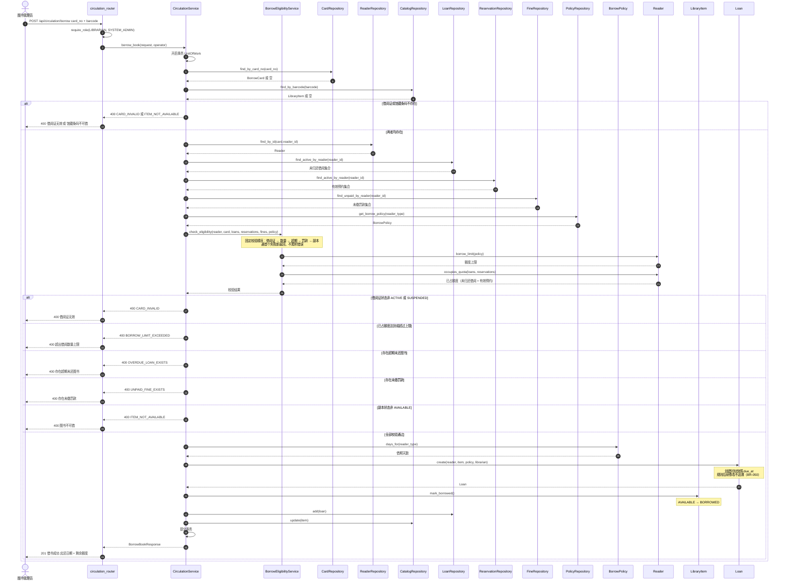

# 顺序图：办理借书（UC-101）

> **文档编号**：`specs/10-sequence-borrow-book.md`
> **制定依据**：`03-use-cases.md`（UC-101）、`09-design-model.md`（§2）
> **版本**：v1.0
> **日期**：2026-09-20
>
> **绘图工具**：实验文档建议文件名 `10-sequence-borrow-book.puml`（PlantUML）。本项目依 `constitution.md` 第三条改用 **Mermaid**（选型理由见 `04-use-case-model.md` 开头），故扩展名改为 `.md`，图仍以文本形式纳入 Git，满足 UML-as-Spec 要求。
>
> **参与对象与实验文档建议名的对应**：`circulation_router` = `LibrarianController`；`CatalogRepository` = `LibraryItemRepository`；`CardRepository` = `BorrowCardRepository`；`BorrowPolicy` = `BorrowPolicyService`。完整对照见 `09-design-model.md` §1.3。

---

## 1. 正常流程与异常分支

---

## 2. 与用例文本的对应关系

| 用例步骤（UC-101） | 图中体现 | 判定 |
|---|---|---|
| 校验图书管理员权限 | `require_role` + 六项校验首项 | ✅ |
| 输入借阅证号与馆藏条码 | 第 1 条消息 | ✅ |
| 校验借阅证存在且有效 | `CardRepository.find_by_card_no` + `CARD_NOT_ACTIVE` 分支 | ✅ |
| 检查当前未归还数量是否超限 | `occupies_quota` + `BORROW_LIMIT_EXCEEDED` 分支 | ✅ |
| 检查是否存在超期未还 | `OVERDUE_EXISTS` 分支 | ✅ |
| 检查是否存在未缴罚款 | `UNPAID_FINE_EXISTS` 分支 | ✅ |
| 验证副本存在且可借 | `find_by_barcode` + `ITEM_NOT_AVAILABLE` 分支 | ✅ |
| 创建 `Loan` | `Loan.create(...)` | ✅ |
| 设置应还日期 | `BorrowPolicy.days_for` + `due_at` 快照 | ✅ |
| 更新副本状态为 `BORROWED` | `LibraryItem.mark_borrowed()` | ✅ |
| 记录操作人 | `operator` 作为 `librarian_id` 写入 `Loan` | ✅ |

**异常覆盖核对**（实验二步骤 2 要求；状态码与错误码依 `02` FR-016 验收标准 2，**均为 400**）：

| 要求表达的异常 | 图中分支 | 错误码 |
|---|---|---|
| 借阅证无效 | `alt` 第 1 分支（`CARD_INVALID`） | 400 |
| 超过借阅数量 | `alt` 第 2 分支 | `BORROW_LIMIT_EXCEEDED` 400 |
| 存在超期未还 | `alt` 第 3 分支 | `OVERDUE_LOAN_EXISTS` 400 |
| 图书不可借 | `alt` 第 5 分支 | `ITEM_NOT_AVAILABLE` 400 |
| （额外补充）未缴罚款 | `alt` 第 4 分支 | `UNPAID_FINE_EXISTS` 400 |
| （额外补充）借阅证/条码不存在 | 外层 `alt` 第 1 分支 | `CARD_INVALID` / `ITEM_NOT_AVAILABLE` 400 |

> **实现提示**：`07-architecture.md` §6.2 的异常→HTTP 通用映射把业务规则失败归到 409，但 `02` FR-016 明确规定为 **400**。**以 FR 为准**——这是本项目唯一一处「通用映射 vs 具体 FR」的差异，已在 `07`、`09`、`14` 三处加注说明。

---

## 3. 变更记录

| 版本 | 日期 | 变更内容 | 变更人 |
|---|---|---|---|
| v1.0 | 2026-09-20 | 初版制定。含正常流程与 6 个异常分支（alt/else），参与对象 14 个，覆盖实验二步骤 2 要求的全部异常场景并补充 2 项。 | Agent 起草 |
| v1.1 | 2026-09-20 | 异常分支的错误码与状态码按 `02` FR-016 校准：六项校验失败统一为 **400**，错误码 `CARD_INVALID`/`BORROW_LIMIT_EXCEEDED`/`OVERDUE_LOAN_EXISTS`/`UNPAID_FINE_EXISTS`/`ITEM_NOT_AVAILABLE`；原 404/409 写法作废。 | Agent 编 API 时交叉核对发现并修订 |
