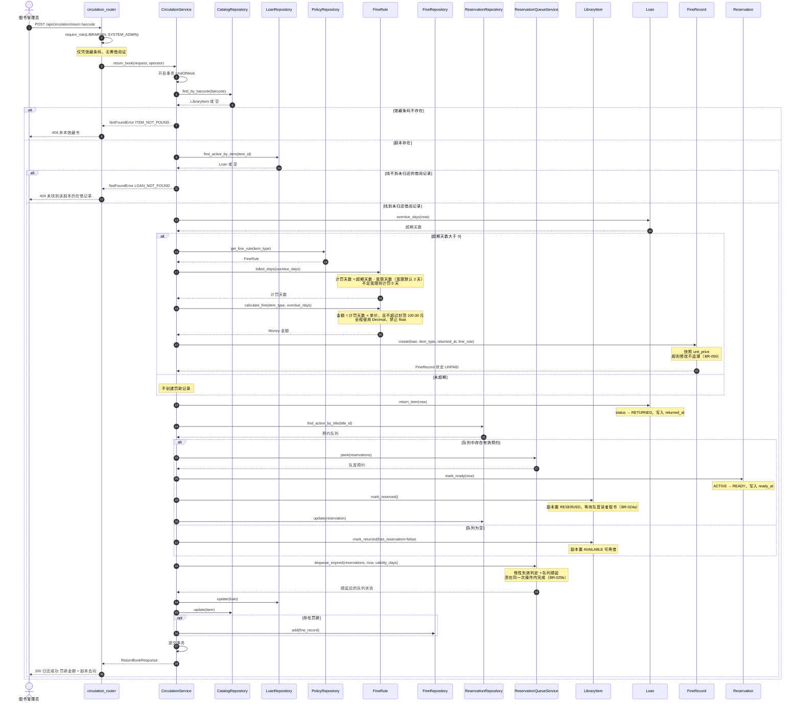

# 顺序图：办理还书（UC-102）

> **文档编号**：`specs/11-sequence-return-book.md`
> **制定依据**：`03-use-cases.md`（UC-102、UC-102a）、`09-design-model.md`（§3、§8）
> **版本**：v1.0
> **日期**：2026-09-20
>
> **绘图工具**：实验文档建议 `11-sequence-return-book.puml`；本项目依 `constitution.md` 第三条改用 **Mermaid**，故扩展名为 `.md`（理由见 `10-sequence-borrow-book.md` 头部说明）。
>
> **参与对象对应**：`circulation_router` = `LibrarianController`；`CatalogRepository` = `LibraryItemRepository`；`FineRule` = `FineRuleService`；罚款计算在本项目内聚于 `CirculationService` + `FineRule`，不单设 `FineService`（理由见 `09-design-model.md` §1.3）。

---

## 1. 正常流程、异常分支与罚款计算

---

## 2. 与用例文本的对应关系

| 用例步骤（UC-102） | 图中体现 | 判定 |
|---|---|---|
| 输入馆藏条码（不要求借阅证） | 第 1 条消息 + `Note over C` | ✅ |
| 验证馆藏副本存在 | `find_by_barcode` + `ITEM_NOT_FOUND` 分支 | ✅ |
| 查找未归还 `Loan` | `find_active_by_item` + `LOAN_NOT_FOUND` 分支 | ✅ |
| 设置归还时间 | `Loan.return_item(now)` 写入 `returned_at` | ✅ |
| 更新 `Loan` 状态为 `RETURNED` | 同上 | ✅ |
| 更新 `LibraryItem` 状态 | `mark_returned` / `mark_reserved` 两分支 | ✅ |
| 超期则生成 `FineRecord` | `alt 超期天数大于 0` 分支链 | ✅ |
| 处理预约预留 | `peek` → `mark_ready` → `mark_reserved` | ✅ |

**异常覆盖核对**（实验二步骤 3 要求）：

| 要求表达的异常 | 图中分支 |
|---|---|
| 图书不是本馆藏书 | 外层 `alt` 第 1 分支（`ITEM_NOT_FOUND`，404） |
| 找不到借阅记录 | 内层 `alt` 第 1 分支（`LOAN_NOT_FOUND`，404） |
| 超期罚款计算流程 | 内层 `alt` 第 1 分支完整计算链（含宽限与封顶说明） |

**与 UC-102a 的关系**：UC-102a「计算超期罚款」被 UC-102 **include**，因此在图中**不出现独立的调用入口**，而是以内嵌分支的形式呈现（`04-use-case-model.md` 图 5 已表达该 include 关系）。

---

## 3. 计算示例（用于核对图与规则的一致性）

| 应还日期 | 归还日期 | 超期天数 | 计罚天数 | 单价（外文书） | 金额 |
|---|---|---:|---:|---:|---:|
| 2026-09-10 | 2026-09-11 | 1 | 0 | 0.50 | 0.00 |
| 2026-09-10 | 2026-09-12 | 2 | 0 | 0.50 | 0.00 |
| 2026-09-10 | 2026-09-13 | 3 | 1 | 0.50 | 0.50 |
| 2026-09-10 | 2026-10-01 | 21 | 19 | 0.50 | 9.50 |
| 2026-09-10 | 2027-09-10 | 365 | 363 | 1.00 | 100.00（封顶） |

---

## 4. 变更记录

| 版本 | 日期 | 变更内容 | 变更人 |
|---|---|---|---|
| v1.0 | 2026-09-20 | 初版制定。含正常流程、2 个异常分支、超期罚款完整计算链与预约预留分支；附 5 行金额计算示例。 | Agent 起草 |
