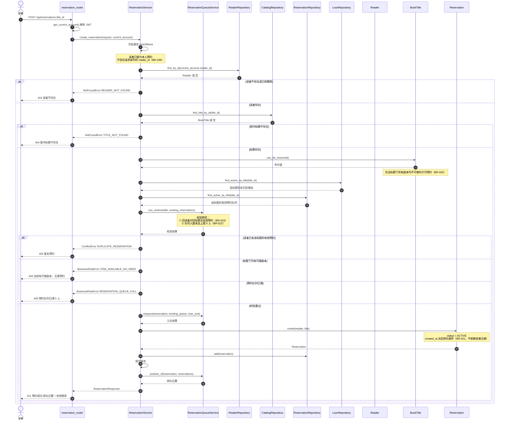

# 顺序图：预约图书（UC-005）

> **文档编号**：`specs/12-sequence-reserve-book.md`
> **制定依据**：`03-use-cases.md`（UC-005）、`09-design-model.md`（§4）
> **版本**：v1.0
> **日期**：2026-09-20
>
> **绘图工具**：实验文档建议 `12-sequence-reserve-book.puml`；本项目依 `constitution.md` 第三条改用 **Mermaid**，故扩展名为 `.md`（理由见 `10-sequence-borrow-book.md` 头部说明）。
>
> **参与对象对应**：`reservation_router` = `ReaderController`；`CatalogRepository` = `BookTitleRepository`；`CatalogRepository` 在本项目内同时承载题录与副本的访问。

---

## 1. 正常流程与异常分支

---

## 2. 排队顺序的体现

预约队列**显式按 `created_at` 升序**排序，**不使用自增主键**——自增主键在不同并发路径下可能乱序（`05-domain-model.md` §6.1）。

| 预约 | `created_at` | 队列位置 | 状态 |
|---|---|---:|---|
| 预约 A | 2026-09-20 09:00 | 1（队首） | `ACTIVE` |
| 预约 B | 2026-09-20 10:30 | 2 | `ACTIVE` |
| 预约 C | 2026-09-20 14:00 | 3 | `ACTIVE` |

当该标题有副本归还时：队首（预约 A）置 `READY`，副本置 `RESERVED`（`11-sequence-return-book.md`）；**A 失效或被取消时，副本转交 B**，仍保持 `RESERVED`（BR-024a）；队列清空才释放为 `AVAILABLE`。

---

## 3. 与用例文本的对应关系

| 用例步骤（UC-005） | 图中体现 | 判定 |
|---|---|---|
| 读者登录并提交预约 | `get_current_account` + `POST /api/reservations` | ✅ |
| 读者必须存在 | `RR.find_by_id` + `READER_NOT_FOUND` 分支 | ✅ |
| 图书标题必须存在 | `TR.find_title_by_id` + `TITLE_NOT_FOUND` 分支 | ✅ |
| 仅当无可借副本才可预约 | `BookTitle.can_be_reserved` + `ITEM_AVAILABLE_NO_NEED` 分支 | ✅ |
| 同一读者不能重复预约同一标题 | `can_reserve` + `DUPLICATE_RESERVATION` 分支 | ✅ |
| 队列上限 5 人 | `can_reserve` + `RESERVATION_QUEUE_FULL` 分支 | ✅ |
| 预约按 `created_at` 排队 | `Reservation.create` + 本节排队示例表 | ✅ |
| 返回排队位置 | `position_of` → `ReservationResponse` | ✅ |

**异常覆盖核对**（实验二步骤 4 要求）：

| 要求表达的异常 | 图中分支 |
|---|---|
| 读者不存在 | 外层 `alt` 第 1 分支（404） |
| 标题不存在 | 内层 `alt` 第 1 分支（404） |
| 重复预约 | `alt` 第 1 分支（409） |
| （额外补充）队列已满 | `alt` 第 3 分支（409） |
| （额外补充）有可借副本无需预约 | `alt` 第 2 分支（409） |
| 预约排队顺序 | §2 排队顺序表 + `position_of` 返回位置 |

---

## 4. 变更记录

| 版本 | 日期 | 变更内容 | 变更人 |
|---|---|---|---|
| v1.0 | 2026-09-20 | 初版制定。含正常流程与 5 个异常分支（alt/else），参与对象 12 个；单列排队顺序说明表，明确按 `created_at` 排序而非自增主键。 | Agent 起草 |
