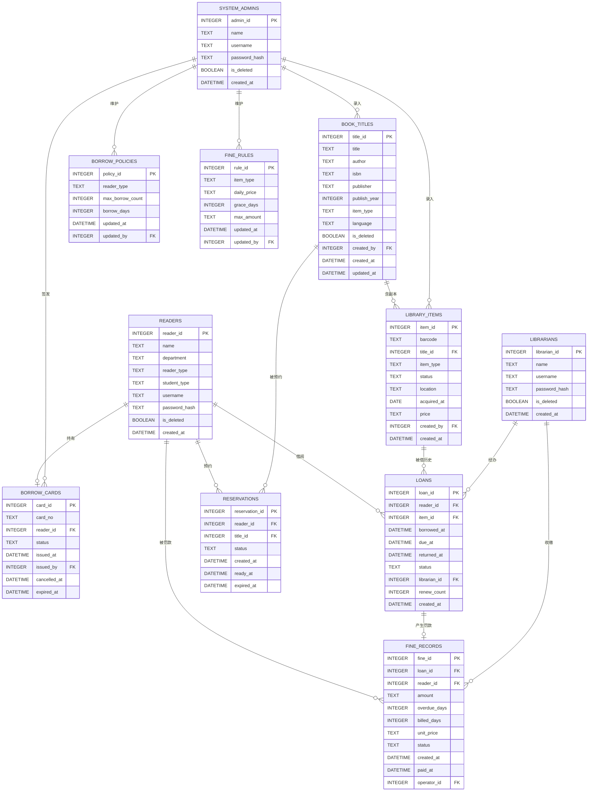

# 数据库设计（Database Design）

> **文档编号**：`specs/13-database-design.md`
> **制定依据**：`05-domain-model.md`、`07-architecture.md`、`01-clarifying-questions.md`（D-47 ~ D-50）、`02-requirements.md`（BR-001 ~ BR-050）
> **版本**：v1.0
> **日期**：2026-09-19
>
> 本文件定义系统的**关系模式**：表结构、字段类型、约束、索引、外键，以及领域模型到表结构的映射策略。
>
> **定位**：本文件是**领域模型的持久化投影**，不是领域模型本身。领域模型见 `05-domain-model.md`；本文件只回答"这些领域对象如何落到关系表"。
>
> **数据库**：SQLite 3（决策 D-47）

---

## 1. 设计约定

### 1.1 命名规范（宪法第十三条）

| 对象 | 规范 | 示例 |
|---|---|---|
| 表名 | 复数小写下划线 | `borrow_cards`、`library_items` |
| 字段名 | 小写下划线 | `reader_id`、`created_at` |
| 主键 | `<单数表名>_id` | `readers` → `reader_id` |
| 外键 | 引用表的主键名 | `reader_id`、`title_id`、`item_id` |
| 布尔字段 | `is_` 前缀 | `is_deleted` |
| 时间字段 | `_at` 后缀 | `borrowed_at`、`paid_at` |
| 索引 | `idx_<表>_<字段>` | `idx_loans_reader_status` |
| 唯一索引 | `uq_<表>_<字段>` | `uq_readers_username` |

### 1.2 类型映射

| 领域概念 | SQL 类型（SQLite） | SQLAlchemy 类型 | 说明 |
|---|---|---|---|
| 标识 | `INTEGER` | `Integer` | 自增主键 |
| 字符串（短） | `VARCHAR(n)` | `String(n)` | 定长字段如用户名、条码 |
| 字符串（长） | `TEXT` | `Text` | 题名、备注 |
| 枚举 | `VARCHAR(n)` | `String(n)` + `CheckConstraint` | **存字符串而非整数**，可读性优先 |
| 布尔 | `BOOLEAN` | `Boolean` | SQLite 内部存 0/1 |
| 整数 | `INTEGER` | `Integer` | 数量、天数、次数 |
| **金额** | `TEXT`（见 §1.3） | 自定义 `MoneyType` | **不用 REAL** |
| 时间戳 | `DATETIME` | `DateTime` | 统一存 UTC（宪法第十四条） |
| 日期 | `DATE` | `Date` | 仅 `acquired_at` 使用 |

### 1.3 金额字段的类型选择（关键决策）

**问题**：SQLite 没有原生 `DECIMAL` 类型。SQLAlchemy 的 `Numeric` 在 SQLite 上默认降级为 `REAL`（浮点），这会**重新引入** `02-requirements.md` Q-04 识别出的精度问题——`0.20 × 3 = 0.6000000000000001`。

**决策**：金额字段以 **`TEXT` 存储、`Decimal` 读写**，通过 SQLAlchemy `TypeDecorator` 封装。

**为什么不用"整数存分"**：整数分方案（`daily_price_cents INTEGER`）同样能解决精度问题，但有两个代价——① 字段名带 `_cents` 后缀，与领域模型的 `Money` 语义脱节；② 直接查库时看到 `20` 需心算才能理解是 0.20 元。而 TEXT 方案直接查库看到 `"0.20"`，可读性更好，且 SQLite 对字符串比较与排序的开销在本项目规模下可忽略。

**实现形态**：

```python
# infrastructure/db/types.py
class MoneyType(TypeDecorator):
    """金额类型：底层存 TEXT，读写为 Decimal，保证精度。"""
    impl = String(20)
    cache_ok = True

    def process_bind_param(self, value: Decimal | None, dialect) -> str | None:
        if value is None:
            return None
        return str(Decimal(value).quantize(Decimal("0.01")))

    def process_result_value(self, value: str | None, dialect) -> Decimal | None:
        if value is None:
            return None
        return Decimal(value)
```

**约束**：所有金额字段必须使用 `MoneyType`，**严禁**使用 `Float` 或裸 `Numeric`。

### 1.4 时间处理（宪法第十四条）

| 规则 | 说明 |
|---|---|
| 存储 | 全部 UTC |
| 类型 | `DateTime`（**不带** `timezone=True`，SQLite 无时区类型） |
| 写入 | 应用层统一用 `datetime.now(timezone.utc)`，**禁用** `datetime.now()` |
| 读取 | 读出后视为 UTC，序列化时补 `Z` 后缀 |
| API 传输 | ISO 8601 带时区，如 `2026-09-19T06:44:25Z` |
| 超期判定 | **精确到时刻**（`returned_at > due_at`），不按自然日 |

### 1.5 软删除约定（宪法第十五条、BR-036）

| 对象 | 软删除方式 | 字段 |
|---|---|---|
| 读者 / 馆员 / 系统管理员 | 标记 | `is_deleted` |
| 借阅证 | 状态置 `CANCELLED` | `status`（**不设** `is_deleted`） |
| 图书标题 | 标记 | `is_deleted` |
| 馆藏副本 | 状态置 `REMOVED` | `status`（**不设** `is_deleted`） |
| 借阅记录 / 罚款记录 | **永不删除** | — |

**为什么借阅证与副本不用 `is_deleted`**：它们的领域模型已有状态枚举（`CardStatus`、`ItemStatus`），删除只是状态流转的一个分支。再加 `is_deleted` 会造成两个字段表达同一语义，出现"状态为 `ACTIVE` 但 `is_deleted=true`"这类矛盾数据。

**可见性**：已软删除的记录**仅系统管理员可查**（BR-037）。过滤在应用层完成。

---

## 2. ER 图



---

## 3. 表清单总览

| # | 表名 | 中文名 | 领域对象 | 预计行量级 | 软删除 |
|:---:|---|---|---|---|---|
| 1 | `readers` | 读者 | `Reader` 继承体系 | 千 | `is_deleted` |
| 2 | `librarians` | 图书管理员 | `Librarian` | 十 | `is_deleted` |
| 3 | `system_admins` | 系统管理员 | `SystemAdmin` | 个 | `is_deleted` |
| 4 | `borrow_cards` | 借阅证 | `BorrowCard` | 千 | `status=CANCELLED` |
| 5 | `book_titles` | 图书题录 | `BookTitle` | 万 | `is_deleted` |
| 6 | `library_items` | 馆藏副本 | `LibraryItem` 继承体系 | 十万 | `status=REMOVED` |
| 7 | `loans` | 借阅记录 | `Loan` | 十万 | **不删** |
| 8 | `reservations` | 预约记录 | `Reservation` | 千 | **不删** |
| 9 | `fine_records` | 罚款记录 | `FineRecord` | 千 | **不删** |
| 10 | `borrow_policies` | 借阅规则 | `BorrowPolicy` | 5 | 不删 |
| 11 | `fine_rules` | 罚款规则 | `FineRule` | 5 | 不删 |

**总表数：11 张**，与领域模型的 11 个实体一一对应——**除 `Reader` 继承体系占 3 张表**（`readers` / `librarians` / `system_admins`），因为三者无继承关系（见 `08-package-diagram.md` §5 与 `06-domain-class-diagram.md` §10.2）。

---

## 4. 表结构详细定义

### 4.1 `readers` — 读者表

承载 `Reader` ← `StudentReader` / `TeacherReader` 的**单表继承**（决策 D-49）。

| 字段 | 类型 | 约束 | 说明 |
|---|---|---|---|
| `reader_id` | INTEGER | PK, AUTOINCREMENT | 主键 |
| `name` | VARCHAR(64) | NOT NULL | 姓名 |
| `department` | VARCHAR(128) | NOT NULL | 院系或单位 |
| `reader_type` | VARCHAR(20) | NOT NULL, CHECK | `COLLEGE` / `UNDERGRADUATE` / `GRADUATE` / `DOCTOR` / `TEACHER` |
| `student_type` | VARCHAR(20) | **NULL** | 仅学生读者有值；取值同 `reader_type` 的前四项 |
| `username` | VARCHAR(32) | NOT NULL, **UNIQUE** | 登录名 |
| `password_hash` | VARCHAR(60) | NOT NULL | bcrypt 哈希（固定 60 字符） |
| `is_deleted` | BOOLEAN | NOT NULL, DEFAULT 0 | 软删除标记 |
| `created_at` | DATETIME | NOT NULL | 注册时间（UTC） |
| `updated_at` | DATETIME | NULL | 最后修改时间（UTC） |

**CHECK 约束**：

```sql
CHECK (reader_type IN ('COLLEGE','UNDERGRADUATE','GRADUATE','DOCTOR','TEACHER'))
CHECK (student_type IS NULL OR student_type IN ('COLLEGE','UNDERGRADUATE','GRADUATE','DOCTOR'))
-- 学生读者必有 student_type，教师必无
CHECK (
  (reader_type = 'TEACHER' AND student_type IS NULL)
  OR (reader_type <> 'TEACHER' AND student_type IS NOT NULL)
)
```

**单表继承的判别字段**：`reader_type`。

- `reader_type = 'TEACHER'` → 映射为 `TeacherReader`
- `reader_type IN ('COLLEGE','UNDERGRADUATE','GRADUATE','DOCTOR')` → 映射为 `StudentReader`
- `student_type` 对 `TeacherReader` 为 `NULL`，对 `StudentReader` 有值

**为什么保留两个近似字段**：`reader_type` 是**继承判别器**（决定哪个子类），`student_type` 是**业务属性**（学生读者的学历层次）。虽然当前取值重叠，但语义不同——若将来引入"访问学者"这类教师子类型，`reader_type` 需要扩展而 `student_type` 不变。合并成一个字段会让继承判别与业务属性耦合。

---

### 4.2 `librarians` — 图书管理员表

| 字段 | 类型 | 约束 | 说明 |
|---|---|---|---|
| `librarian_id` | INTEGER | PK, AUTOINCREMENT | 主键 |
| `name` | VARCHAR(64) | NOT NULL | 姓名 |
| `username` | VARCHAR(32) | NOT NULL, **UNIQUE** | 登录名 |
| `password_hash` | VARCHAR(60) | NOT NULL | bcrypt 哈希 |
| `is_deleted` | BOOLEAN | NOT NULL, DEFAULT 0 | 软删除标记 |
| `created_at` | DATETIME | NOT NULL | 创建时间（UTC） |
| `updated_at` | DATETIME | NULL | 最后修改时间（UTC） |

**设计说明**：不继承 `readers`（`06-domain-class-diagram.md` §10.2），故独立建表。**不提供在线创建接口**，由系统管理员创建（BR-041）。

---

### 4.3 `system_admins` — 系统管理员表

| 字段 | 类型 | 约束 | 说明 |
|---|---|---|---|
| `admin_id` | INTEGER | PK, AUTOINCREMENT | 主键 |
| `name` | VARCHAR(64) | NOT NULL | 姓名 |
| `username` | VARCHAR(32) | NOT NULL, **UNIQUE** | 登录名 |
| `password_hash` | VARCHAR(60) | NOT NULL | bcrypt 哈希 |
| `is_deleted` | BOOLEAN | NOT NULL, DEFAULT 0 | 软删除标记 |
| `created_at` | DATETIME | NOT NULL | 创建时间（UTC） |
| `updated_at` | DATETIME | NULL | 最后修改时间（UTC） |

**约束**：

- **无在线创建接口**，仅由初始化脚本创建（决策 D-04）。
- 系统管理员之间**不可互相删除**（BR-043）——此约束在**应用层**实现（需检查"至少保留一个可用管理员"），不建数据库约束。
- 软删除后不可登录，但历史留痕中其 ID 仍可追溯。

**为什么三类账号的用户名不跨表唯一**：`readers`、`librarians`、`system_admins` 三表的 `username` 各自 `UNIQUE`，但**跨表允许重名**。这是 BR-044（一名自然人每个角色最多一个账号）的自然结果——同一个自然人可以同时是读者和馆员，各持一个同名账号。登录时按角色入口区分（读者端 / 管理端）。

---

### 4.4 `borrow_cards` — 借阅证表

| 字段 | 类型 | 约束 | 说明 |
|---|---|---|---|
| `card_id` | INTEGER | PK, AUTOINCREMENT | 主键 |
| `card_no` | VARCHAR(14) | NOT NULL, **UNIQUE** | 证号，格式 `CARD` + 4 位年 + 6 位序号 |
| `reader_id` | INTEGER | NOT NULL, FK → `readers.reader_id` | 所属读者 |
| `status` | VARCHAR(20) | NOT NULL, CHECK | `ACTIVE` / `SUSPENDED` / `CANCELLED` / `EXPIRED` |
| `issued_at` | DATETIME | NOT NULL | 办证时间（UTC） |
| `issued_by` | INTEGER | NOT NULL, FK → `system_admins.admin_id` | 签发人 |
| `cancelled_at` | DATETIME | NULL | 注销时间（UTC） |
| `expired_at` | DATETIME | NULL | **保留不用**（BR-005） |

**CHECK 约束**：

```sql
CHECK (status IN ('ACTIVE','SUSPENDED','CANCELLED','EXPIRED'))
CHECK (length(card_no) = 14 AND card_no LIKE 'CARD%')
```

**"一名读者最多一张有效证"（BR-003）如何保证**

这是**部分唯一索引**的典型场景——约束只在 `status IN ('ACTIVE','SUSPENDED')` 时生效：

```sql
CREATE UNIQUE INDEX uq_borrow_cards_active_reader
  ON borrow_cards(reader_id)
  WHERE status IN ('ACTIVE', 'SUSPENDED');
```

`CANCELLED` 证不计入（BR-003），因此该读者可重新办证；历史注销记录保有任意多条。

**`card_no` 全局唯一且软删除不释放**：证号是流水号，永不复用。即使证已注销，`CARD2026000001` 也不会再分配给他人。

**序号生成**：

```sql
-- 取当年最大序号 + 1
SELECT MAX(CAST(SUBSTR(card_no, 9, 6) AS INTEGER))
FROM borrow_cards
WHERE SUBSTR(card_no, 5, 4) = :year;
```

`card_no` 结构：`CARD`(4) + 年份(4) + 序号(6) = 14 字符，故 `SUBSTR(card_no, 5, 4)` 取年份、`SUBSTR(card_no, 9, 6)` 取序号。

**并发风险**：该 `MAX + 1` 生成方式在两个并发办证请求下会撞号。缓解措施：
1. `card_no` 上的 UNIQUE 约束会拒绝重复，触点失败即回滚
2. 办证为低频操作（由管理员手工执行），实际冲突概率极低
3. 若需严格保证，可在应用层对该查询加显式事务（本项目已具备）

---

### 4.5 `book_titles` — 图书题录表

| 字段 | 类型 | 约束 | 说明 |
|---|---|---|---|
| `title_id` | INTEGER | PK, AUTOINCREMENT | 主键 |
| `title` | TEXT | NOT NULL | 题名 |
| `author` | VARCHAR(128) | NULL | 作者 |
| `isbn` | VARCHAR(20) | NULL | ISBN（可空） |
| `publisher` | VARCHAR(128) | NULL | 出版社 |
| `publish_year` | INTEGER | NULL | 出版年份 |
| `item_type` | VARCHAR(20) | NOT NULL, CHECK | 五种借出物类型 |
| `language` | VARCHAR(20) | NULL | 语种 |
| `is_deleted` | BOOLEAN | NOT NULL, DEFAULT 0 | 软删除标记 |
| `created_by` | INTEGER | FK → `system_admins.admin_id` | 录入人 |
| `created_at` | DATETIME | NOT NULL | 创建时间（UTC） |
| `updated_at` | DATETIME | NULL | 最后修改时间（UTC） |

**CHECK 约束**：

```sql
CHECK (item_type IN ('CHINESE_BOOK','FOREIGN_BOOK','CHINESE_MAGAZINE','FOREIGN_MAGAZINE','THESIS'))
CHECK (publish_year IS NULL OR (publish_year BETWEEN 1000 AND 2100))
```

**`isbn` 的唯一约束与软删除的冲突处理（关键设计）**

**问题**：`05-domain-model.md` §4.1 要求 `isbn` 若填写则全局唯一。但若采用全局唯一索引，则：

```
场景：图书馆录入《算法导论》→ 全部副本下架，题录软删除
     → 半年后重新采购同一版《算法导论》→ 录入相同 ISBN → 唯一约束拒绝
```

这是**真实且常见的业务场景**，全局唯一索引会导致无法重新采购已下架的书。

**决策**：`isbn` 采用**部分唯一索引**，仅约束未删除的题录：

```sql
CREATE UNIQUE INDEX uq_book_titles_isbn_active
  ON book_titles(isbn)
  WHERE isbn IS NOT NULL AND is_deleted = 0;
```

**效果**：

| 场景 | 是否允许 |
|---|---|
| 两本活跃题录共用同一 ISBN | ❌ 拒绝 |
| 一本活跃 + 一本已软删除共用同一 ISBN | ✅ 允许（重新采购场景） |
| 多本已软删除题录共用同一 ISBN | ✅ 允许（历史多次上下架） |
| 多本活跃题录 `isbn` 为 NULL | ✅ 允许（`WHERE isbn IS NOT NULL` 排除） |

**为什么 `username` 用全局唯一而 `isbn` 用部分唯一**——两者的业务语义不同：

| 字段 | 唯一性语义 | 理由 |
|---|---|---|
| `username` | **全局且不随软删除释放** | 用户名是**身份标识**，释放后他人可注册同名账号，存在冒用风险。故软删除后仍占用（对应 `02-requirements.md` Q-03） |
| `isbn` | **仅活跃记录唯一** | ISBN 是**出版物标识**，不是系统身份。已下架的书重新采购是正常业务，不应被阻塞 |

**这个区分是本文件最重要的设计判断**，人工审查时应重点确认。

---

### 4.6 `library_items` — 馆藏副本表

承载 `LibraryItem` ← `Book` / `Magazine` / `Thesis` 的**单表继承**（决策 D-50）。

| 字段 | 类型 | 约束 | 说明 |
|---|---|---|---|
| `item_id` | INTEGER | PK, AUTOINCREMENT | 主键 |
| `barcode` | VARCHAR(10) | NOT NULL, **UNIQUE** | 条码，格式 `BC` + 8 位数字 |
| `title_id` | INTEGER | NOT NULL, FK → `book_titles.title_id` | 所属题录 |
| `item_type` | VARCHAR(20) | NOT NULL, CHECK | 冗余自题录，见下 |
| `status` | VARCHAR(20) | NOT NULL, CHECK | 六种副本状态 |
| `location` | VARCHAR(64) | NULL | 存放位置 |
| `acquired_at` | DATE | NULL | 入库日期 |
| `price` | TEXT (MoneyType) | NULL | 定价 |
| `created_by` | INTEGER | FK → `system_admins.admin_id` | 录入人 |
| `created_at` | DATETIME | NOT NULL | 创建时间（UTC） |

**CHECK 约束**：

```sql
CHECK (status IN ('AVAILABLE','BORROWED','RESERVED','LOST','DAMAGED','REMOVED'))
CHECK (item_type IN ('CHINESE_BOOK','FOREIGN_BOOK','CHINESE_MAGAZINE','FOREIGN_MAGAZINE','THESIS'))
CHECK (length(barcode) = 10 AND barcode LIKE 'BC%')
```

**`item_type` 为何在两表都出现（冗余说明）**

`book_titles.item_type` 是**权威定义**，`library_items.item_type` 是**受控冗余**。理由：

1. **罚款计算路径不 join**。`FineRule` 的单价按借出物类型查表，而罚款在还书时触发——此时手上只有 `Loan.item_id`。若无冗余，每次还书都要 `library_items → book_titles` join 一次才能确定单价。冗余后在副本上直接读到类型。
2. **一致性由应用层保证**。新增副本时，`item_type` 必须取自所属题录，不允许独立填写。
3. **代价可接受**：`item_type` 是题录级属性，一个题录下的所有副本类型必然相同，不存在副本间不一致的可能。

**`barcode` 全局唯一且软删除不释放**：条码是贴在实体书上的物理标签。书下架（`REMOVED`）后标签不回收、不复用。故用全局唯一索引：

```sql
CREATE UNIQUE INDEX uq_library_items_barcode ON library_items(barcode);
```

**`status` 与题录软删除的联动**（BR-042）：题录软删除时，其下未借出副本同步置 `REMOVED`；已借出副本待归还后置 `REMOVED`。此逻辑在**应用层**实现，不建触发器——因为"已借出副本待归还后处理"需要跨时间点的状态追踪，触发器难以表达。

---

### 4.7 `loans` — 借阅记录表

| 字段 | 类型 | 约束 | 说明 |
|---|---|---|---|
| `loan_id` | INTEGER | PK, AUTOINCREMENT | 主键 |
| `reader_id` | INTEGER | NOT NULL, FK → `readers.reader_id` | 借阅人 |
| `item_id` | INTEGER | NOT NULL, FK → `library_items.item_id` | 被借副本 |
| `borrowed_at` | DATETIME | NOT NULL | 借出时刻（UTC） |
| `due_at` | DATETIME | NOT NULL | 应归还时刻（UTC），**借出时快照** |
| `returned_at` | DATETIME | NULL | 实际归还时刻（UTC） |
| `status` | VARCHAR(20) | NOT NULL, CHECK | 见下 |
| `librarian_id` | INTEGER | NOT NULL, FK → `librarians.librarian_id` | 经办人（BR-018/D-18） |
| `renew_count` | INTEGER | NOT NULL, DEFAULT 0 | 已续借次数（0-2） |
| `created_at` | DATETIME | NOT NULL | 记录创建时间（UTC） |

**CHECK 约束**：

```sql
-- 持久化只存两态；OVERDUE 为派生状态（见 05-domain-model.md §5.1）
CHECK (status IN ('BORROWED','RETURNED'))
CHECK (renew_count BETWEEN 0 AND 2)
CHECK (returned_at IS NULL OR returned_at >= borrowed_at)
CHECK (due_at > borrowed_at)
```

**`status` 只存两态的决策依据**

`05-domain-model.md` §5.1 明确 `OVERDUE` 是**派生状态**——由 `due_at` 与当前时刻实时判定，无须持久化。持久化三态会引入**数据陈旧风险**：一条 `BORROWED` 记录过了 `due_at` 后，其 `status` 字段需要有人在某个时刻改成 `OVERDUE`，而这个"某个时刻"无人负责。存两态则永远一致。

**代价**：查询"超期记录"时必须写 `status = 'BORROWED' AND due_at < :now`，无法直接 `status = 'OVERDUE'`。这个代价用索引消化（见 §5）。

**额度占用口径的落库表达**（BR-007）——额度 = 未归还借阅 + 有效预约：

```sql
-- 未归还借阅数（含超期）
SELECT COUNT(*) FROM loans
WHERE reader_id = :reader_id AND status = 'BORROWED';
```

**`due_at` 快照与规则不追溯**（BR-050）：`due_at` 在借出时刻由 `BorrowPolicy` 计算后写入，此后规则表无论如何修改，该记录的 `due_at` 不变。这是 BR-050 落地的唯一机制——**应用层无须任何额外判断**。

---

### 4.8 `reservations` — 预约记录表

| 字段 | 类型 | 约束 | 说明 |
|---|---|---|---|
| `reservation_id` | INTEGER | PK, AUTOINCREMENT | 主键 |
| `reader_id` | INTEGER | NOT NULL, FK → `readers.reader_id` | 预约人 |
| `title_id` | INTEGER | NOT NULL, FK → `book_titles.title_id` | 预约的**题录**（非副本） |
| `status` | VARCHAR(20) | NOT NULL, CHECK | 四态 |
| `created_at` | DATETIME | NOT NULL | 创建时刻（UTC），**决定排队顺序** |
| `ready_at` | DATETIME | NULL | 到书可借时刻（UTC） |
| `expired_at` | DATETIME | NULL | 失效时刻（UTC） |

**CHECK 约束**：

```sql
CHECK (status IN ('ACTIVE','READY','EXPIRED','CANCELLED'))
CHECK (ready_at IS NULL OR ready_at >= created_at)
CHECK (expired_at IS NULL OR expired_at >= created_at)
```

**"同一读者对同一题录不得有多个有效预约"（BR-023）**

部分唯一索引：

```sql
CREATE UNIQUE INDEX uq_reservations_active_reader_title
  ON reservations(reader_id, title_id)
  WHERE status IN ('ACTIVE', 'READY');
```

已失效或已取消的预约不占用该约束，故同一读者对同一题录可有多条历史预约。

**队列顺序由 `created_at` 决定（BR-021）**

```sql
-- 队列（按创建时刻升序，隐含排队位置）
SELECT * FROM reservations
WHERE title_id = :title_id AND status IN ('ACTIVE','READY')
ORDER BY created_at ASC, reservation_id ASC;
```

**为什么用 `created_at` 而非自增主键排序**：`reservation_id` 在同一秒内的并发插入顺序不可靠（ACID 只保证唯一，不保证提交顺序与 ID 顺序一致）。`created_at` 精确到微秒，且加了 `reservation_id` 作为**稳定的次序打破者**（tie-breaker），确保排序结果确定。

**队列上限 5 人（BR-022）**：在应用层用 `COUNT` 校验，不建数据库约束（数据库无法表达"每分组最多 N 行"）。

**有效期 7 天的惰性判定**（`02-requirements.md` Q-01）：不引入定时任务，在查询预约状态时计算 `created_at`（`ACTIVE`）或 `ready_at`（`READY`）是否已超 7 天。

---

### 4.9 `fine_records` — 罚款记录表

| 字段 | 类型 | 约束 | 说明 |
|---|---|---|---|
| `fine_id` | INTEGER | PK, AUTOINCREMENT | 主键 |
| `loan_id` | INTEGER | NOT NULL, **UNIQUE**, FK → `loans.loan_id` | 关联借阅 |
| `reader_id` | INTEGER | NOT NULL, FK → `readers.reader_id` | 被罚款读者 |
| `amount` | TEXT (MoneyType) | NOT NULL | 罚款金额 |
| `overdue_days` | INTEGER | NOT NULL | 逾期天数 |
| `billed_days` | INTEGER | NOT NULL | 计罚天数（扣宽限期后） |
| `unit_price` | TEXT (MoneyType) | NOT NULL | 计算时单价（**快照**） |
| `status` | VARCHAR(20) | NOT NULL, CHECK | `UNPAID` / `PAID` |
| `created_at` | DATETIME | NOT NULL | 产生时刻（UTC） |
| `paid_at` | DATETIME | NULL | 缴纳时刻（UTC） |
| `operator_id` | INTEGER | **NULL**, FK | 收缴经办人；馆员与管理员共用此列，见下 |

**CHECK 约束**：

```sql
CHECK (status IN ('UNPAID','PAID'))
CHECK (overdue_days >= 0)
CHECK (billed_days >= 0)
CHECK (billed_days <= overdue_days)
CHECK ((status = 'PAID') = (paid_at IS NOT NULL))   -- 状态与时间必须一致
```

**`loan_id` 唯一 → 罚款的唯一性**（BR-029）：一条借阅记录最多产生一条罚款。额外罚款由 `loans.status` 与 `returned_at` 决定，无重复生成路径。

**`unit_price` 快照与规则不追溯**（BR-050）：与 `loans.due_at` 同理——`unit_price` 在罚款生成时写入，此后 `fine_rules` 的修改不影响该记录。**同时** `overdue_days` / `billed_days` 也一并快照，使该记录完全自描述，事后可独立复核计算过程而不依赖当前规则。

**`operator_id` 的跨表引用问题**

罚款可由**图书管理员**（BR-031）或**系统管理员**收缴，两者在不同的表。方案对比：

| 方案 | 做法 | 取舍 |
|---|---|---|
| **A. 单列不加外键**（选用） | `operator_id INTEGER`，无 FK 约束，另加 `operator_role` 标识 | 简单；失去引用完整性 |
| B. 双列 | `librarian_id` + `admin_id`，互斥可空 | 保留 FK；但查询需 `COALESCE`，CHECK 复杂 |
| C. 统一账号表 | 三表合并 | 违背"员工账号不共享基类"的决策（ADR-08） |

**选用方案 A**，并加 `operator_role VARCHAR(20)`：

```sql
CHECK (operator_role IN ('LIBRARIAN','ADMIN'))
CHECK (operator_id IS NULL OR operator_role IS NOT NULL)
```

**理由**：罚款收缴人只用于**留痕与展示**，不参与任何业务规则判定（不需要 join 取姓名以外的东西）。为保留 FK 而引入双列，会让"谁收的"这个简单查询变成 `COALESCE(librarian_id, admin_id)`。方案 A 的代价是失去引用完整性——即可能存一个不存在的 `operator_id`。鉴于该字段由应用层从 JWT token 取当前登录人写入，**不存在用户可伪造的入口**，风险可控。

---

### 4.10 `borrow_policies` — 借阅规则表

| 字段 | 类型 | 约束 | 说明 |
|---|---|---|---|
| `policy_id` | INTEGER | PK, AUTOINCREMENT | 主键 |
| `reader_type` | VARCHAR(20) | NOT NULL, **UNIQUE**, CHECK | 读者类型 |
| `max_borrow_count` | INTEGER | NOT NULL, CHECK > 0 | 最大借阅数量 |
| `borrow_days` | INTEGER | NOT NULL, CHECK > 0 | 借阅期限（天） |
| `updated_at` | DATETIME | NULL | 最后修改时间（UTC） |
| `updated_by` | INTEGER | NULL, FK → `system_admins.admin_id` | 最后修改人 |

**CHECK 约束**：

```sql
CHECK (reader_type IN ('COLLEGE','UNDERGRADUATE','GRADUATE','DOCTOR','TEACHER'))
CHECK (max_borrow_count > 0)
CHECK (borrow_days > 0)
```

**初始数据**（D-12，5 行）：

| reader_type | max_borrow_count | borrow_days |
|---|---:|---:|
| `COLLEGE` | 5 | 30 |
| `UNDERGRADUATE` | 5 | 30 |
| `GRADUATE` | 10 | 60 |
| `DOCTOR` | 15 | 90 |
| `TEACHER` | 20 | 90 |

**规则必须存库**（BR-049）：代码中**严禁**出现 `if reader_type == 'UNDERGRADUATE': return 5` 这类分支。此表的 `UNIQUE(reader_type)` 约束保证每种读者类型恰有一条规则。

**`updated_by` 可空**：初始种子数据由脚本写入，此时无操作人。

---

### 4.11 `fine_rules` — 罚款规则表

| 字段 | 类型 | 约束 | 说明 |
|---|---|---|---|
| `rule_id` | INTEGER | PK, AUTOINCREMENT | 主键 |
| `item_type` | VARCHAR(20) | NOT NULL, **UNIQUE**, CHECK | 借出物类型 |
| `daily_price` | TEXT (MoneyType) | NOT NULL, CHECK >= 0 | 日罚款单价 |
| `grace_days` | INTEGER | NOT NULL, CHECK >= 0 | 宽限期天数 |
| `max_amount` | TEXT (MoneyType) | NOT NULL, CHECK > 0 | 单笔封顶金额 |
| `updated_at` | DATETIME | NULL | 最后修改时间（UTC） |
| `updated_by` | INTEGER | NULL, FK → `system_admins.admin_id` | 最后修改人 |

**CHECK 约束**：

```sql
CHECK (item_type IN ('CHINESE_BOOK','FOREIGN_BOOK','CHINESE_MAGAZINE','FOREIGN_MAGAZINE','THESIS'))
CHECK (grace_days >= 0)
```

**初始数据**（D-25、D-26，5 行）：

| item_type | daily_price | grace_days | max_amount |
|---|---:|---:|---:|
| `CHINESE_BOOK` | 0.20 | 2 | 100.00 |
| `FOREIGN_BOOK` | 0.50 | 2 | 100.00 |
| `CHINESE_MAGAZINE` | 0.10 | 2 | 100.00 |
| `FOREIGN_MAGAZINE` | 0.20 | 2 | 100.00 |
| `THESIS` | 1.00 | 2 | 100.00 |

**`daily_price` 的 CHECK 说明**：金额存为 TEXT，**无法在 SQL 层做数值比较**（`'10.00' < '2.00'` 按字典序成立）。因此非负校验放在**应用层**，数据库层只保证 `grace_days` 这类整数字段。这是 TEXT 存金额方案的一个明确代价。

**计算规则**（BR-027）：

```
billed_days = max(overdue_days - grace_days, 0)
amount      = min(billed_days × daily_price, max_amount)
```

---

## 5. 索引设计

索引按**实际查询路径**设计，不为"可能用到"建索引。

### 5.1 唯一索引

| 索引名 | 表 | 字段 | 类型 | 说明 |
|---|---|---|---|---|
| `uq_readers_username` | `readers` | `username` | 全局唯一 | 用户名软删除不释放（Q-03） |
| `uq_librarians_username` | `librarians` | `username` | 全局唯一 | — |
| `uq_system_admins_username` | `system_admins` | `username` | 全局唯一 | — |
| `uq_borrow_cards_card_no` | `borrow_cards` | `card_no` | 全局唯一 | 证号永不复用 |
| `uq_borrow_cards_active_reader` | `borrow_cards` | `reader_id` | **部分唯一** | `WHERE status IN ('ACTIVE','SUSPENDED')`（BR-003） |
| `uq_book_titles_isbn_active` | `book_titles` | `isbn` | **部分唯一** | `WHERE isbn IS NOT NULL AND is_deleted = 0` |
| `uq_library_items_barcode` | `library_items` | `barcode` | 全局唯一 | 物理标签不复用 |
| `uq_reservations_active_reader_title` | `reservations` | `reader_id, title_id` | **部分唯一** | `WHERE status IN ('ACTIVE','READY')`（BR-023） |
| `uq_fine_records_loan` | `fine_records` | `loan_id` | 全局唯一 | 一借阅一罚款 |
| `uq_borrow_policies_reader_type` | `borrow_policies` | `reader_type` | 全局唯一 | 每类型一条规则 |
| `uq_fine_rules_item_type` | `fine_rules` | `item_type` | 全局唯一 | 每类型一条规则 |

**部分唯一索引是 SQLite 支持的特性**（`CREATE UNIQUE INDEX ... WHERE ...`）。它是解决"软删除与唯一约束冲突"的标准手段，本项目在 3 处使用。

### 5.2 查询索引

| 索引名 | 表 | 字段 | 服务的查询 |
|---|---|---|---|
| `idx_loans_reader_status` | `loans` | `reader_id, status` | 额度占用计算（BR-007）、读者查自己的借阅（UC-004） |
| `idx_loans_item_status` | `loans` | `item_id, status` | 还书时按条码查未归还记录（UC-102） |
| `idx_loans_overdue` | `loans` | `status, due_at` | 登录时查超期提醒（UC-008）、馆员查超期 |
| `idx_reservations_title_status_created` | `reservations` | `title_id, status, created_at` | 取队列与队首（BR-021） |
| `idx_reservations_reader_status` | `reservations` | `reader_id, status` | 额度占用计算、读者查自己的预约 |
| `idx_fine_records_reader_status` | `fine_records` | `reader_id, status` | 未缴罚款校验（BR-011）、读者查罚款 |
| `idx_library_items_title_status` | `library_items` | `title_id, status` | 可借性判断（BR-020/BR-033）、可借副本数 |
| `idx_book_titles_search` | `book_titles` | `title, is_deleted` | 题名检索（UC-003） |
| `idx_borrow_cards_reader_status` | `borrow_cards` | `reader_id, status` | 查读者有效证 |

**关键索引说明**：

- **`idx_loans_overdue` 是超期查询的支撑**。因为 `status` 只存两态、`OVERDUE` 为派生，超期查询写成 `status = 'BORROWED' AND due_at < :now`。该复合索引让这个"半等值 + 半范围"查询走索引而非全表扫描。
- **`idx_reservations_title_status_created` 的字段顺序有讲究**：等值条件（`title_id`、`status`）在前，排序字段（`created_at`）在后，这样队列查询可同时完成过滤与排序，避免额外排序步骤。
- **题名检索未用全文索引**：`00-project-brief.md` §9 明确"复杂全文检索"为**暂不实现**项。当前用 `LIKE '%关键字%'` 前缀模糊匹配，`idx_book_titles_search` 只能辅助 `is_deleted` 过滤，无法加速 `LIKE`。在本项目数据规模下可接受。

### 5.3 索引数量评估

| 项 | 数量 |
|---|---:|
| 唯一索引 | 11 |
| 查询索引 | 9 |
| **合计** | **20** |

表 11 张、索引 20 个，平均每表 1.8 个。鉴于本项目**读远多于写**（查询书、查借阅、查罚款），这个比例合理——写操作增加少量索引维护成本，换取查询路径全部走索引。

---

## 6. 领域模型 → 表结构映射对照

### 6.1 继承关系的映射策略

| 领域继承 | 映射策略 | 落表 |
|---|---|---|
| `Reader` ← `StudentReader` / `TeacherReader` | **单表继承** | `readers`（`reader_type` 判别） |
| `LibraryItem` ← `Book` / `Magazine` / `Thesis` | **单表继承** | `library_items`（`item_type` 判别） |
| `Reader` 与 `Librarian` / `SystemAdmin` 无继承 | **独立建表** | `readers` / `librarians` / `system_admins` |

**为什么这两处继承用单表而非多表**

| 考量 | 单表继承 | 多表继承（类表继承） |
|---|---|---|
| 子类独有属性 | **几乎没有**——`StudentReader` 仅多一个 `student_type`；`Book`/`Magazine`/`Thesis` 属性完全相同 | — |
| 查询成本 | 单表查询，无需 join | 每次查基类都要 join 所有子表 |
| 代价 | 可空字段（`student_type` 对教师为 NULL） | 表数量翻倍，实现复杂度上升 |
| 适用条件 | **子类差异小** | 子类差异大且有大量独有字段 |

本项目的子类差异极小（`Book`/`Magazine`/`Thesis` 甚至**完全无属性差异**，仅语义分类），单表继承是明确更优的选择。实验要求"领域模型体现继承"——继承在**领域层**充分体现了（`06-domain-class-diagram.md` 图 1、图 3），数据库层不必照搬。

### 6.2 值对象的映射

| 值对象 | 映射方式 | 落表字段 | 说明 |
|---|---|---|---|
| `CardNumber` | **内联为列** | `borrow_cards.card_no` | 格式校验在领域层 |
| `Barcode` | **内联为列** | `library_items.barcode` | 同上 |
| `Isbn` | **内联为列** | `book_titles.isbn` | 可空 |
| `Money` | **内联为列 + TypeDecorator** | `fine_records.amount`、`unit_price`、`fine_rules.daily_price`、`max_amount`、`library_items.price` | 底层 TEXT 保证精度 |
| `DateRange` | **拆为两列** | `loans.borrowed_at` + `loans.due_at` | 区间是派生概念，无须独立类型 |

**值对象不单独建表的理由**：它们在业务上没有独立标识，也没有被多处引用的需求。为 `Money` 建一张 `money` 表是典型的过度设计。

**`DateRange` 的拆列说明**：`DateRange` 在领域层是 `start` + `end` 的组合（`05-domain-model.md` §5.2）。持久化时拆为 `borrowed_at` 与 `due_at` 两列——因为区间本身不需要被独立查询或引用，且借阅记录本来就需要这两个时刻用于超期判定。

### 6.3 枚举的映射

| 枚举 | 存储方式 | 取值 |
|---|---|---|
| `ReaderType` | `VARCHAR(20)` + CHECK | `COLLEGE` / `UNDERGRADUATE` / `GRADUATE` / `DOCTOR` / `TEACHER` |
| `ItemType` | `VARCHAR(20)` + CHECK | `CHINESE_BOOK` / `FOREIGN_BOOK` / `CHINESE_MAGAZINE` / `FOREIGN_MAGAZINE` / `THESIS` |
| `ItemStatus` | `VARCHAR(20)` + CHECK | `AVAILABLE` / `BORROWED` / `RESERVED` / `LOST` / `DAMAGED` / `REMOVED` |
| `CardStatus` | `VARCHAR(20)` + CHECK | `ACTIVE` / `SUSPENDED` / `CANCELLED` / `EXPIRED` |
| `LoanStatus` | `VARCHAR(20)` + CHECK | `BORROWED` / `RETURNED`（`OVERDUE` 派生，不入库） |
| `ReservationStatus` | `VARCHAR(20)` + CHECK | `ACTIVE` / `READY` / `EXPIRED` / `CANCELLED` |
| `FineStatus` | `VARCHAR(20)` + CHECK | `UNPAID` / `PAID` |

**为什么存字符串而非整数**：直接查库时 `status = 'OVERDUE'` 比 `status = 2` 可读得多，且免去维护枚举码表的负担。存储开销差异在本项目规模下可忽略。代价是字符串比较略慢于整数——已由索引抵消。

**CHECK 约束的必要性**：SQLite 无原生 ENUM 类型，`CHECK` 是对应手段。它把枚举取值约束**固化到数据库层**，即使应用层有 bug 也无法写入非法值。

---

## 7. 种子数据

依据决策 D-48，初始化脚本 `backend/scripts/init_db.py` 写入：

| 类别 | 数量 | 内容 |
|---|---:|---|
| 系统管理员 | 1 | 用户名 `admin`（密码由脚本参数指定） |
| 图书管理员 | 2 | 覆盖借还书操作演示 |
| 读者 | 5 | 覆盖五种 `reader_type`，其中至少 2 人已办证 |
| 借阅证 | ≥ 2 | 对应已办证读者 |
| 图书题录 | ~10 | 覆盖五种 `item_type` |
| 馆藏副本 | ~20 | 分布在不同题录下 |
| 借阅规则 | 5 | `borrow_policies` 全量初始值 |
| 罚款规则 | 5 | `fine_rules` 全量初始值 |

**规则表的种子数据是系统可用的**前提**——若 `borrow_policies` 为空，任何借书操作都无法确定借期。因此初始化脚本**必须**写入规则，且脚本要可重复执行（幂等：存在则跳过）。

**系统管理员必须先于其他数据创建**，因为 `borrow_cards.issued_by`、`book_titles.created_by` 等字段引用 `system_admins.admin_id`。

---

## 8. 与领域模型、架构的对照

| 项 | 来源 | 落库情况 |
|---|---|---|
| 11 个领域实体 | `05-domain-model.md` §1.2 | ✅ 11 张表（`Reader` 体系占 3 张） |
| 13 个值对象/枚举 | `05-domain-model.md` §1.2 | ✅ 值对象内联为列，枚举用 VARCHAR + CHECK |
| `Money` 用 Decimal | `05-domain-model.md` §7.2、Q-04 | ✅ `MoneyType` 底层 TEXT |
| `due_at` 快照 | BR-050 | ✅ 借出时写入，无更新路径 |
| `unit_price` 快照 | BR-050 | ✅ 罚款生成时写入 |
| `OVERDUE` 为派生状态 | `05-domain-model.md` §5.1 | ✅ `status` 只存两态，超期用 `due_at` 判定 |
| 单表继承 | D-49、D-50 | ✅ `readers`、`library_items` |
| 软删除 | 宪法第十五条 | ✅ `is_deleted` / `status` 两套机制 |
| 软删除可见性分级 | BR-037 | ✅ 应用层过滤（数据库不区分） |
| 时间存 UTC | 宪法第十四条 | ✅ `DateTime` 无时区，应用层保证写 UTC |
| 规则存库不硬编码 | BR-049 | ✅ `borrow_policies`、`fine_rules` |
| 事务边界 | 宪法第九条、D-46c | ✅ 见 §9，不建触发器 |
| 无乐观锁 | ADR-03 | ✅ 未建 `version` 字段 |
| 表名复数小写下划线 | 宪法第十三条 | ✅ 全部 11 张表 |

---

## 9. 事务与并发

**事务边界由应用服务层控制**（宪法第九条），**数据库层不建触发器**——触发器会把业务逻辑从领域层偷渡到数据库，违背宪法第八条。

| 操作 | 涉及表 | 事务范围 |
|---|---|---|
| 办理借书 | `loans`(写) + `library_items`(写) + 读 4 张 | 校验 → 创建 Loan → 副本置 BORROWED |
| 办理还书 | `loans`(写) + `library_items`(写) + `fine_records`(写) + `reservations`(写) | 更新 Loan → 更新副本 → 生成罚款 → 处理预约预留 |
| 预约图书 | `reservations`(写) + 读 `book_titles`、既有预约 | 校验队列 → 创建 Reservation |
| 办理借阅证 | `borrow_cards`(写) + 读 `readers` | 校验 → 生成证号 → 创建 |
| 续借 | `loans`(写) | 校验次数 → 更新 `due_at` → 递增 `renew_count` |

**并发控制**：依赖 SQLite 的写串行化 + 事务原子性，**不引入**乐观锁版本号（ADR-03）。

**已知的并发风险点**：

| 风险 | 场景 | 缓解 |
|---|---|---|
| 证号撞号 | 两个管理员同时办证 | `card_no` UNIQUE 约束拒绝，后者失败重试 |
| 队列超员 | 两个读者同时预约第 5 个位置 | 应用层在同一事务内 `COUNT` + `INSERT`；SQLite 写串行化保证串行 |
| 副本重复借出 | 两馆员同时为同一副本办借书 | `library_items.status` 条件更新 + UNIQUE 约束兜底 |

**ADR-03 明确预留的扩展位**：若后续迁移到 PostgreSQL 且存在真实并发，需为 `library_items`、`loans`、`reservations` 增加 `version INTEGER NOT NULL DEFAULT 0` 字段实现乐观锁。当前**不建**该字段。

---

## 10. 与实验文档及宪法的对照

| 要求 | 覆盖情况 |
|---|---|
| 须给出关系模式（表、字段、类型、约束） | ✅ §4 全部 11 张表逐字段定义 |
| 须体现主键与外键 | ✅ PK/FK 标注，FK 关系见 §2 ER 图 |
| 须体现实体间关系 | ✅ §2 ER 图 + §4 各表关系说明 |
| 须说明继承关系的映射 | ✅ §6.1 单表继承策略与选型论证 |
| 须给出索引设计 | ✅ §5，20 个索引含 3 个部分唯一索引 |
| 须与领域模型一致 | ✅ §6 映射对照 + §8 逐项核对 |
| 须说明初始化数据 | ✅ §7 种子数据 |
| **宪法第十三条** 命名规范 | ✅ §1.1，全部 11 张表复数小写下划线 |
| **宪法第十四条** 时间存 UTC | ✅ §1.4 |
| **宪法第十五条** 软删除 | ✅ §1.5，并区分两套机制 |

---

## 11. 人工审查重点自查

| 审查项 | 自查结果 |
|---|---|
| 表数与领域实体是否对应？ | ✅ 11 张表 ↔ 11 个实体；`Reader` 体系占 3 张（因无继承关系） |
| 继承关系映射是否合理？ | ✅ §6.1 给出单表继承的适用条件与代价，论证子类差异极小 |
| 主键、外键是否完整？ | ✅ §4 各表逐项标注；`fine_records.operator_id` 例外已说明理由（§4.9） |
| 软删除与唯一约束是否冲突？ | ✅ §4.5 详细论证 ISBN 用部分唯一、用户名用全局唯一，并给出语义区分表 |
| 金额精度是否保证？ | ✅ §1.3 `MoneyType` 底层 TEXT，并说明不用整数分的原因 |
| 时间是否统一 UTC？ | ✅ §1.4，含禁用 `datetime.now()` 的明确约束 |
| 索引是否由查询路径驱动？ | ✅ §5.2 每个索引标注服务的查询，并说明字段顺序理由 |
| 枚举约束是否落到数据库？ | ✅ §6.3 全部枚举配 CHECK 约束 |
| 是否有过度设计？ | ✅ 未建 `version`（ADR-03）；值对象不单独建表；无全文索引（超出范围） |
| 是否引入触发器？ | ✅ 明确不建，业务逻辑保留在领域层（宪法第八条） |
| 事务边界是否与架构一致？ | ✅ §9 与 `07-architecture.md` §6.3 逐项对应 |

---

## 12. 变更记录

| 版本 | 日期 | 变更内容 | 变更人 |
|---|---|---|---|
| v1.0 | 2026-09-19 | 初版制定。11 张表完整关系模式、20 个索引（含 3 个部分唯一索引）、单表继承映射策略、金额精度方案（`MoneyType`）、软删除与唯一约束冲突处理、种子数据。 | Agent 起草 |
